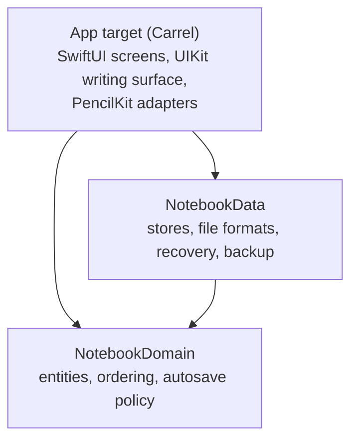

# Architecture

A one-page map. The reasoning behind each decision is in the
[proposal, part 3](docs/proposal/03-architecture.md) and in [docs/adr](docs/adr).

## Layers



Dependencies point inward. `NotebookDomain` imports only Foundation. `NotebookData` adds CryptoKit and
Apple Archive. Neither knows about UIKit or PencilKit: ink crosses the boundary as `InkData`, opaque bytes
plus the PencilKit content version needed to read them. Both run their tests on the Mac host with `swift test`.

| Where | What |
|---|---|
| `Packages/CarrelKit/Sources/NotebookDomain` | `Notebook`, `Page`, `Folder`, `Paper`, `Cover`, `SortKey`, `AutosavePolicy` |
| `Packages/CarrelKit/Sources/NotebookData` | `LibraryStore`, `NotebookStore`, `InkEnvelope`, `LibraryArchive`, safe file writes |
| `Carrel/App` | `CarrelApp`, `AppDependencies` (the composition root) |
| `Carrel/Features/Library` | Library, folders, trash, new notebook sheet |
| `Carrel/Features/Editor` | `EditorSession`, the UIKit canvas controller, palettes, page overview |
| `Carrel/Features/Settings` | Backup, restore, about |
| `Carrel/Services` | `InkCodec`, `PaperRenderer`, `PDFExporter` |
| `Carrel/DesignSystem` | Reading Room colors, type, spacing, motion, ink palette, covers |

## Data on disk

```text
Application Support/Carrel/
├── Library/                       # everything a backup contains
│   ├── library.json(.previous)    # folders and tags
│   └── Notebooks/<id>.notebook/
│       ├── notebook.json(.previous)
│       └── ink/<pageID>.ink(.previous)
├── Snapshots/<id>/<timestamp>.notebook   # APFS clones taken when a notebook is opened
└── Recovered/                     # damaged files and libraries replaced by a restore; never cleaned
```

- Every write replaces the file atomically and keeps the previous generation. Reads fall back to it.
- An ink file is an envelope with a length and a SHA-256, so damage is detected before PencilKit sees it.
- The manifest records that a page has ink before its ink file first appears; a missing file is then
  recovered, never shown as an empty page.
- Ink written by a newer PencilKit opens read-only and is never rewritten.

## Saving

`EditorSession` keeps the latest drawing of every edited page and writes it after 2 s of rest, at most 5 s after
the first unsaved change, and immediately when the scene becomes inactive. If the app crashes, at most 5 s of
continuous writing is lost. Saves run one at a time, so an older drawing can never overwrite a newer one.

## Writing surface

`NotebookCanvasViewController` stacks pages in a zoomable `UIScrollView`. Only pages near the visible area get a
live `PKCanvasView`; the others show a cached image. A canvas belongs to one page for its whole life, so undo
history can never be applied to the wrong page. Drawings never pass through SwiftUI state.

## Concurrency

The app target defaults to `MainActor` isolation. Storage lives in actors (`LibraryStore`, one `NotebookStore`
per notebook) that are the only writers of their files.
