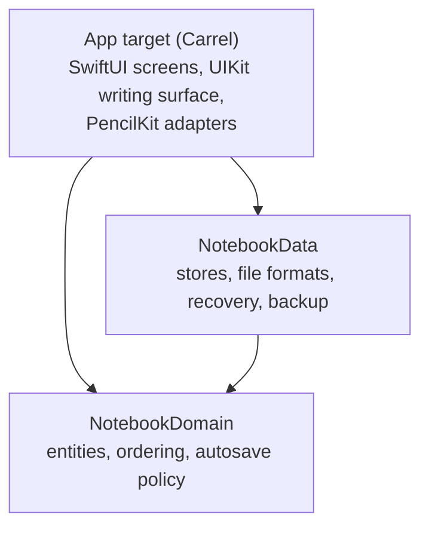

# Architecture

A one-page map. The reasoning behind each decision is in the
[proposal, part 3](docs/proposal/03-architecture.md) and in [docs/adr](docs/adr).

## Layers



Dependencies point inward. `NotebookDomain` imports only Foundation. `NotebookData` adds CryptoKit, ImageIO
(downscaling imported images and encoding them as HEIC), Apple Archive, System (file paths for Apple Archive) and
Observation (the autosaver's save status). Neither knows about UIKit or PencilKit: ink crosses the boundary as
`InkData`, opaque bytes plus the PencilKit content version needed to read them, and images as files the editor
reads from the URL its store resolves. Both run their tests on the Mac host with `swift test`.

| Where | What |
|---|---|
| `Packages/CarrelKit/Sources/NotebookDomain` | `Notebook`, `Page`, `PageSize`, `ImagePlacement`, `PageRect`, `Folder`, `Paper`, `Cover`, `SortKey`, `Title`, `AutosavePolicy` |
| `Packages/CarrelKit/Sources/NotebookData` | `LibraryStore` (catalog and folders), `NotebookStore` (one notebook and every edit of it), `InkAutosaver`, `SnapshotStore`, `LibraryBackup`, `InkEnvelope`, `ImageAssetEncoder`, `VersionedFile`, `SchemaMigration`, `LibraryLayout` |
| `Carrel/App` | `CarrelApp`, `AppDependencies` (the composition root) |
| `Carrel/Features/Library` | `LibraryModel`, library screens, new notebook sheet |
| `Carrel/Features/Editor` | `EditorSession`, `DrawingCache`, `NotebookCanvasViewController`, `PageStackLayout`, `PencilInteractionHandler`, `ToolPaletteModel`, palettes, page overview |
| `Carrel/Features/Settings` | `BackupModel`, settings screen |
| `Carrel/Features/Shared` | `UserFacingError`, the error alert, presentation bindings, the share sheet |
| `Carrel/Services` | `InkCodec`, `InkRenderer`, `PaperRenderer`, `PDFExporter`, `BackgroundTask` |
| `Carrel/DesignSystem` | Reading Room `Palette` and `Theme`, `InkPalette`, `CoverAppearance`, paper previews and names |

## Design rules

- **One reason to change per type.** Storage is split by what it owns: `LibraryStore` the catalog,
  `NotebookStore` one package and the rules for editing it (sort keys, modification dates, the Trash),
  `InkAutosaver` when ink is written, `SnapshotStore` and `LibraryBackup` the safety nets. In the editor,
  `EditorSession` connects the screen to a `NotebookStore`, `DrawingCache` holds the live drawings,
  `PageStackLayout` the geometry and `PencilInteractionHandler` the Apple Pencil gestures.
- **Abstractions where they pay for themselves.** Views and models depend on the concrete stores: there is one
  implementation, and tests run them against temporary directories, which exercises the real file handling
  instead of a mock. Volatile inputs are injected instead: time (`now:` parameters), `UserDefaults`
  (`ToolPaletteModel`, `BackupModel`), the autosave policy (`EditorSession`, `InkAutosaver`) and the library
  location (`LibraryLayout`). A protocol is introduced together with a second implementation, not before.
- **Logic lives where it can be tested quickly.** Anything that does not need UIKit lives in the package and
  runs with `swift test` on the Mac; app-side logic is pure where possible (`PageStackLayout`). The
  `CarrelTests` target covers the models and the editor session against real stores in temporary directories.
- **No duplicated knowledge.** Colors come from `Palette`, file generations from `VersionedFile`, title rules
  from `Title`, page-structure rules from `NotebookStore`, the Trash retention from `LibraryStore`, error
  wording from `UserFacingError`.
- **Errors reach the user.** Every action that writes reports a failure through the screen's `errorMessage`;
  nothing that touches the user's notes is discarded with `try?`. The exceptions are safety nets, such as a
  snapshot, whose failure must not keep the user from writing.

## Data on disk

```text
Application Support/Carrel/
├── Library/                       # everything a backup contains
│   ├── library.json(.previous)    # folders and tags
│   └── Notebooks/<id>.notebook/
│       ├── notebook.json(.previous)
│       ├── ink/<pageID>.ink(.previous)
│       └── assets/<sha256>.heic   # images, immutable and shared by every placement that shows them
├── Snapshots/<id>/<timestamp>.notebook   # APFS clones taken when a notebook is opened
└── Recovered/                     # damaged files and libraries replaced by a restore; never cleaned
```

- Every write replaces the file atomically and keeps the previous generation. Reads fall back to it, and a
  damaged generation is moved to `Recovered/` so the next save cannot replace the intact one with it.
- An ink file is an envelope with a length and a SHA-256, so damage is detected before PencilKit sees it.
- The manifest records that a page has ink before its ink file first appears. A missing ink file is therefore
  never mistaken for an empty page: its previous generation is used, and if there is none the editor tells the
  user that the page's ink is missing.
- Ink written by a newer PencilKit opens read-only and is never rewritten.
- An imported image is downscaled to at most 4096 px on its long side, stored as HEIC without the original's
  metadata and named by the SHA-256 of the file, so importing it again reuses the file. The file is on disk
  before a page references it. The Trash purge deletes assets that no page uses, counting pages in the Trash and
  the previous generation of the manifest, so a fallback to it never finds an image missing; if that generation
  cannot be read, nothing is deleted. Assets imported or taken off a page since launch are kept until the app
  quits, so undo can bring an image back. When a manifest falls back to its previous generation, the images only
  the lost one showed move to `Recovered/` with it.
- A notebook package that cannot be read stays where it is; the library reports it instead of hiding it.
- A manifest of an older schema version is migrated in memory, in steps over its JSON before decoding, and
  reaches the disk in the new version only with the next change. The library snapshots such a notebook when it
  opens it, so the old version outlives that change. A newer version is neither opened nor rewritten.
- The formats of every schema version are pinned by golden tests (`FileFormatTests`): a change that would make
  existing files unreadable fails the package tests.

## Saving

`DrawingCache` keeps the latest drawing of every edited page. `InkAutosaver` encodes and writes it after 2 s of
rest, at most 5 s after the first unsaved change, and immediately when the scene becomes inactive. If the app
crashes, at most 5 s of continuous writing is lost. Saves run one at a time, so an older drawing can never
overwrite a newer one; the package tests cover this ordering. A failed write is retried and shown as
"Not Saved"; the editor closes only once everything is on disk.

## Writing surface

`NotebookCanvasViewController` stacks pages in a zoomable `UIScrollView`. Only pages near the visible area get a
live `PKCanvasView`, at most four; the others show a rendered image of their ink, which is released on a memory
warning. The drawings of pages opened in this session stay in `DrawingCache` until the editor closes. A canvas
belongs to one page for its whole life, so undo history can never be applied to the wrong page. Drawings never
pass through SwiftUI state.

## Concurrency

The app target defaults to `MainActor` isolation. Storage lives in actors: `LibraryStore` writes `library.json`
and one `NotebookStore` per notebook writes its package, and nothing else writes inside `Library/`. Snapshots are
copied by the notebook's own store, so they include changes it still holds in memory.
