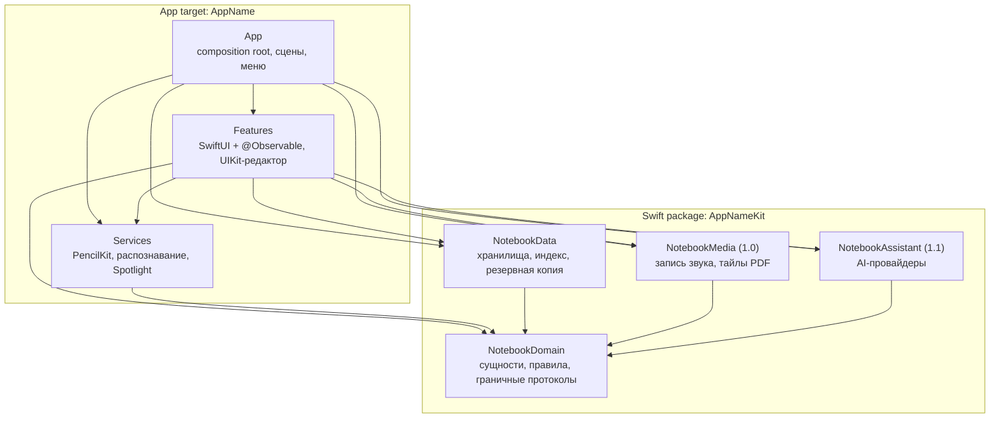

# Product Proposal — Часть 3. Архитектура

> Черновик для обсуждения, 27.10.2026. Рабочее название — **Carrel** ([часть 1](01-product.md)). Метки релизов **MVP**, **1.0** и **Future** — как в части 1; AI-функции выходят в 1.1, первом релизе после 1.0. Минимальная система — iPadOS 27.
>
> Имя продукта не утверждено, поэтому в именах таргета, схемы и пакета стоит плейсхолдер `AppName` / `AppNameKit`. Идентификаторы от имени не зависят: bundle ID `dev.devlet.notebook`, UTType `dev.devlet.notebook.package` и iCloud-контейнер `iCloud.dev.devlet.notebook` не меняются никогда, даже при смене названия ([раздел 9](#9-структура-проекта)). Модули, названные по предметной области (`NotebookDomain`, `NotebookData`), от имени продукта тоже не зависят.

## 8. Архитектура и технологический стек

**Контракт тулчейна.** Собираем в Xcode 27.x (Swift 6.4, SDK iPadOS 27), deployment target — iPadOS 27.0. Минимум 27 — решение владельца: только в iPadOS 27 есть `PKStrokeRecognizer` (распознавание рукописи на устройстве и без сети), стабильный `PKStroke.id`, API выделения лассо (`PKCanvasView.selection`) и Swift API `MetricManager`. Минимум остаётся, даже если русского в распознавателе не окажется (спайк S2): на остальных API держатся смена цвета выделения, будущее слияние штрихов и диагностика. Любой iPad, совместимый с Apple Pencil Pro, получает iPadOS 27, поэтому в коде нет путей для iPadOS 26 и веток `#available` по версии ОС. Xcode 27 требует Mac на Apple silicon с macOS Tahoe 26.6 или новее; конкретный Mac владелец подтверждает на Г1. С первого коммита соблюдаем требования SDK 27: только SwiftUI App lifecycle (сцены обязательны), ключ `UILaunchScreen` в Info.plist, никаких `UIDesignRequiresCompatibility` и `UIRequiresFullScreen`.

### 8.1 Технологический стек

| Область | Выбор | Почему | Отвергнутые альтернативы |
|---|---|---|---|
| Язык | Swift 6 language mode, Swift 6.4 | Гонки данных ловит компилятор, а не пользователь | Swift 5 mode: теряем строгую проверку конкурентности |
| UI | SwiftUI + `@Observable` модели | Liquid Glass, zoom-переходы, сцены и меню — нативно и с минимумом кода | UIKit целиком: атмосферная анимация дороже; TCA: см. [8.9](#89-что-мы-сознательно-не-делаем) |
| Поверхность письма | UIKit-контроллер в `UIViewControllerRepresentable`, внутри пул `PKCanvasView` | Один владелец у канвасов, жестов, скролла и undo; SwiftUI не участвует в каждом штрихе | `UIViewRepresentable` на каждую страницу: SwiftUI пересоздаёт канвасы при смене identity |
| Чернила | PencilKit, один `PKDrawing` на страницу, потолок `maximumSupportedContentVersion = .version5` | Системные перо, задержка, barrel roll и squeeze бесплатно; потолок равен уровню iPadOS 27, минимальной системы, поэтому любой файл читает любое поддерживаемое устройство | Свой движок: годы работы, остаётся запасным путём, если провалится спайк S1. PaperKit: непрозрачный формат и системный стиль разметки |
| Хранение (источник истины) | Файловые пакеты блокнотов: JSON-манифест, файл чернил на страницу, неизменяемые ассеты | Повреждение изолировано страницей, запись затрагивает одну страницу, структура ложится на записи CloudKit | SwiftData/Core Data как основное хранилище: блобы в одном файле БД, одна точка отказа. UIDocument/`DocumentGroup`: см. [8.9](#89-что-мы-сознательно-не-делаем) |
| Каталог и поиск в приложении | MVP: индекс названий в памяти, собранный из сводок манифестов. 1.0: SQLite из системной `libsqlite3` + FTS5, производный и пересобираемый | В MVP ищутся только названия, и отдельное хранилище не окупается. В 1.0 нужен полнотекстовый поиск по десяткам тысяч страниц; миграции каталога не нужны: удалили и пересобрали | SwiftData для каталога: нет полнотекстового индекса. GRDB: сторонняя зависимость |
| PDF (1.0) | PDFKit для импорта и экспорта, `CGPDFPage` в `CATiledLayer` как фон страницы | Один конвейер страниц для пустых и PDF-страниц; исходный PDF не меняется | `PDFView` + `PDFPageOverlayViewProvider`: размытые чернила при зуме, конфликт вложенных scroll view |
| Аудио (1.0) | AVFoundation: `AVAudioEngine` + `AVAudioFile`, сегменты CAF, после остановки — AAC | CAF читается без финализации заголовка, поэтому падение не уничтожает лекцию | `AVAudioRecorder` сразу в `.m4a`: файл, скорее всего, нечитаем после падения |
| Распознавание рукописи (1.0) | `PKStrokeRecognizer`, конкретный тип без протокола | Единственный системный путь к поиску по рукописи: на устройстве, без сети, 29 языков по WWDC26. Русский в списке не подтверждён и проверяется на iPad владельца (S2) | Vision OCR по растру страницы: слабее на рукописи и кириллице. Облачный OCR: бюджет $0 и приватность |
| Расшифровка лекций (Future, 1.1+) | Speech: `SpeechTranscriber`; для ru-RU — `DictationTranscriber` / `SFSpeechRecognizer` on-device | На устройстве и бесплатно; поддержку русского проверяем на устройстве до планирования функции | Транскрипция через OpenAI как основной путь: AI обязан оставаться опциональным |
| Системный поиск (1.0) | Core Spotlight: именованный `CSSearchableIndex` с классом защиты, элемент на страницу | Конспект находится из Spotlight; поверх добавляется App Intents `IndexedEntity` | Default index: Apple не рекомендует его для production |
| Синхронизация (1.0) | CloudKit через `CKSyncEngine` поверх файлового хранилища | Явное разрешение конфликтов на уровне страницы, `CKAsset` для чернил, зона на блокнот | SwiftData + CloudKit: непрозрачный last-writer-wins, ограничения схемы, сбои на iOS 26. Пакеты в iCloud Drive: конфликт целиком на документ |
| AI (1.1, опционально) | Единая точка входа `AssistantRouter`: тексты — через свой протокол `AssistantProvider` (FoundationModels on-device и OpenAI REST через `URLSession`), изображения — маршрутом: системный лист Image Playground или OpenAI Images | Приложение полностью работает без AI; русский текст уходит в OpenAI, потому что Apple Intelligence русский не поддерживает | SDK OpenAI: зависимость. `ImageCreator`: deprecated в iPadOS 27. Private Cloud Compute: управляемый entitlement и дневные лимиты |
| Секреты | Keychain, `kSecAttrAccessibleWhenUnlockedThisDeviceOnly` | Ключ не покидает устройство и не попадает в экспорт | `UserDefaults`, файл |
| Монетизация (позже) | StoreKit 2 | Нативно, $0, async API; архитектура от модели монетизации не зависит | RevenueCat и аналоги |
| Диагностика | `Logger`, `OSSignposter`, MetricKit через Swift API `MetricManager` (iPadOS 27), включая диагностику записи на диск; Xcode Organizer | $0, без сторонних SDK и без отправки данных | Crashlytics, Sentry. `MXMetricManager`: Apple больше не рекомендует его для новых проектов |
| Unit- и интеграционные тесты | Swift Testing | Параметризация, теги, пакет тестируется `swift test` на macOS-хосте без симулятора | XCTest для unit-тестов |
| UI- и performance-тесты | XCTest: `XCUIApplication`, `measure` + `XCTMetric` | Swift Testing не покрывает UI и метрики | Сторонние UI-фреймворки |
| Стиль кода | `swift-format` из тулчейна, `.swift-format` в корне и свой в папках тестов | Ноль дополнительных инструментов, встроен в Xcode, одна версия на Linux и macOS | SwiftLint (Homebrew или плагин-зависимость), nicklockwood/SwiftFormat (второй форматтер) |
| Описание проекта | Коммитим `AppName.xcodeproj` с folder-synchronized groups, настройки — в `.xcconfig` | Добавление файлов не меняет проектный файл, настройки проверяются на ревью как текст, «открыл и запустил» без генераторов | XcodeGen, Tuist: лишний инструмент у каждого участника и в CI, сгенерированный проект в `.gitignore` |
| CI | GitHub Actions: раннер `xcode-27` для сборки и тестов, `ubuntu-24.04` для линта | Для публичного репозитория стандартные раннеры бесплатны и без лимита минут. Образ `xcode-27` на момент исследования был в public preview в runner-images: ярлык подтверждаем в И0, запасной путь — образ macOS с Xcode 27, выбранным через `xcode-select` | Bitrise, CircleCI. Xcode Cloud — только для релизов после вступления в Developer Program |

### 8.2 Архитектурный обзор

Прагматичная Clean Architecture: четыре слоя, зависимости направлены внутрь, а протоколы появляются только там, где у границы больше одной реализации.

- **Domain** (`NotebookDomain`) — сущности и value types (`Notebook`, `Page`, `Folder`, `Tag`, `Asset`, `Recording`, `SortKey`, `PageSize`, `InkData`, `InkHash`, `PageText`), платформенно-независимые правила (порядок страниц, политика автосохранения и статус сохранения, сопоставление штриха с аудио и константа `playbackPreroll`), события `NotebookChange` и протоколы настоящих границ. Импортирует только Foundation.
- **Data** (`NotebookData`) — `LibraryStore` и `NotebookStore`, формат пакета, конверт чернил, снимки, восстановление, резервная копия через `AppleArchive`, индекс названий (MVP), каталог и FTS-индекс на SQLite (1.0), конвейер индексации. Не знает про UIKit, SwiftUI и PencilKit: чернила для него — непрозрачные байты с версией контента.
- **Features** (app target) — SwiftUI views и `@Observable` модели экранов и интерфейса вокруг холста (панели, палитра), UIKit-редактор с канвасами. Рядом лежит папка `Services` с адаптерами платформенных фреймворков: PencilKit-кодек и рендер миниатюр, распознаватель на `PKStrokeRecognizer` (1.0), Core Spotlight (1.0). Адаптеры, чьи системные колбэки приходят вне главного потока, — запись звука и тайловый рендер PDF (1.0) — лежат в таргете пакета `NotebookMedia` с изоляцией `nonisolated` ([ADR-14](#adr-14-модель-конкурентности)).
- **App** (app target) — композиционный корень `AppDependencies`, сцены, команды меню, реакция на `scenePhase`.



**Правило зависимостей.** Domain не зависит ни от чего. Data зависит только от Domain. Фичи пользуются публичным API Data и Domain напрямую. Объекты создаёт только App. Обратных стрелок нет, и это проверяет компилятор, потому что Domain и Data — отдельные SwiftPM-таргеты.

Отступление от «книжной» Clean Architecture сделано сознательно: фичи вызывают конкретные `NotebookStore` и `LibraryStore` без протоколов-репозиториев. Реализация у них одна, а тесты гоняют настоящее хранилище во временной папке. Это быстрее и честнее моков, которые проверяют сами себя.

| Граница | Протокол | Причина |
|---|---|---|
| Распознавание рукописи (1.0) | Нет | Один движок — конкретный тип на `PKStrokeRecognizer`. Протокол появится, только если придёт второй движок |
| AI (1.1) | `AssistantProvider` | Две реальные реализации текстовых функций (Apple on-device, OpenAI) с разными возможностями; фичи обращаются к ним только через `AssistantRouter` |
| Хранилища, каталог, индексатор | Нет | Одна реализация; тесты на реальной файловой системе во временной папке |
| Файловая система, сеть | Нет | Временные папки; для сети — `URLProtocol`-заглушка в тестовой `URLSessionConfiguration` |
| Время | Нет | Политика автосохранения — чистая функция над `ContinuousClock.Instant`, фейковые часы не нужны |
| Миниатюры, запись звука, Spotlight | Нет | Одна реализация; проверяются на симуляторе и устройстве |
| Разрешение конфликтов синхронизации (1.0) | Нет | Слияние метаданных и тегов — чистая функция в `NotebookSync`, тестируется `swift test` без серверов CloudKit; сам движок — конкретный тип |

**Модули.** Один app target и один локальный пакет `Packages/AppNameKit`:

| Модуль | Платформы | Зачем отдельный |
|---|---|---|
| `AppName` (app target) | iPadOS 27 | UI, редактор, платформенные адаптеры; изоляция по умолчанию — `MainActor` |
| `NotebookDomain` | iOS 27, macOS 26 | Компилятор не даёт Domain импортировать хранилище или UI |
| `NotebookData` | iOS 27, macOS 26 | Самая ценная логика (формат, восстановление, резервная копия, индекс) тестируется `swift test` на macOS-хосте за секунды |
| `NotebookMedia` (1.0) | iOS 27, macOS 26 | Запись звука и тайлы PDF: их колбэки приходят на чужих потоках, а изоляция по умолчанию `nonisolated` не даёт компилятору привязать их к главному актору ([ADR-14](#adr-14-модель-конкурентности)) |
| `NotebookAssistant` (1.1) | iOS 27, macOS 26 | Изолирует сеть, ключ и FoundationModels; появляется вместе с AI-функциями |
| `NotebookSync` (1.0) | iOS 27, macOS 26 | CloudKit, записи и слияние метаданных; появляется вместе с синхронизацией |
| `AppNameControls` (1.0, расширение WidgetKit) | iPadOS 27 | `ControlWidget` «Quick Note» в Пункте управления. Его intent открывает приложение и выполняется в процессе приложения, поэтому App Group и координация файлов не нужны |

Платформы пакета объявлены один раз в `Package.swift`: `.iOS(.v27)` и `.macOS(.v26)`. macOS указан только ради быстрых тестов на хосте, и именно 26: Xcode 27 работает на macOS Tahoe 26.6, и `swift test` не должен требовать обновления Mac. Немногие вызовы, которым на macOS нужен SDK 27 (например, `installAudioTap` в `NotebookMedia`), закрыты `#if os(iOS)`; на iPad веток по версии ОС нет. Приложение выходит только на iPad. Фичи не выносим в модули: UI-код всё равно тестируется на симуляторе, поэтому скорости тестов это не добавит, а `public`-boilerplate и накладные расходы Xcode вырастут. Пересмотрим, когда появится второй разработчик на одной фиче или инкрементальная сборка станет мешать работе. Расширение Пункта управления этого не требует: ему нужен только один intent, который компилируется в оба таргета.

### 8.3 Ключевые архитектурные решения

Часть решений упирается в поведение платформы, которое документация не описывает. Эти вопросы закрываем спайками на iPad Air владельца. Проверка списка языков из S2 идёт самой первой: это минуты на устройстве, а от ответа зависит обещание русского поиска. S1, остальная часть S2, S3 и S6 закрываются до UI-работ MVP, S4 и S5 — до своих эпиков 1.0. План по итерациям — в [10.2](04-roadmap.md#102-итерации-mvp).

| Спайк | Вопрос | Критерий успеха | Что блокирует |
|---|---|---|---|
| S1 | Зум и пул канвасов на блокноте из 300 страниц: зум через раскладку или постраничный режим; память undo-снимков; отключение встроенного undo PencilKit. Ввод при включённом рисовании пальцем (`.anyInput`): касания двумя и тремя пальцами выигрывают у `drawingGestureRecognizer`. Даёт ли линейка PencilKit тактильный отклик сама | Чёткие чернила при 1–4x, нет мерцания при письме, 0 hitches при смене страниц, задержка на уровне Apple Notes; при `.anyInput` отмена и повтор пальцами срабатывают и не оставляют точек на странице | Редактор |
| S2 | Есть ли русский в `PKStrokeRecognizer.supportedLanguages`, и качество распознавания русского и английского на iPad владельца (симулятор распознаёт только латиницу) | Русский в списке или нет; доля найденных слов RU и EN на эталонном конспекте (предлагаем порог 80%); цифры в `docs/spikes/` | Русский поиск по рукописи (1.0) |
| S3 | Сохраняется ли `PKStrokePath.creationDate` при лассо, ластике и копировании; переживает ли `PKStroke.id` round-trip через `dataRepresentation()` и `PKDrawing(data:)` с потолком `.version5` | Даты и ID сохраняются или правила их изменения известны | Аудиосинхронизация (1.0), слияние штрихов (1.x) |
| S4 | Аварийная устойчивость записи звука: `kill -9` посреди лекции | Все сегменты воспроизводятся, потеря не больше 1 с | Аудио (1.0) |
| S5 (1.0) | Есть ли FTS5 в системной SQLite (`PRAGMA compile_options`), скорость запроса на 50 тыс. страниц | FTS5 доступен, запрос ≤ 150 мс | Каталог и полнотекстовый поиск (1.0) |
| S6 | Сохранность страниц при сбое: завершение процесса в случайный момент, включая `abort()` между шагами `replaceItemAt`; осиротевший `.ink` без записи в манифесте; пропавший `.ink` при `hasInk == true`; объём записи на диск за учебный день | 50 случайных прерываний без повреждённой страницы, потеря не больше 5 с; восстановление находит осиротевшие и пропавшие файлы и ничего не удаляет; запись ≤ 500 МБ за 6-часовой день по диагностике MetricKit | Хранилище ([ADR-02](#adr-02-формат-пакета-и-конверт-чернил), [ADR-03](#adr-03-атомарная-запись-и-автосохранение)), обещание сохранности |

#### ADR-01. Источник истины — файловые пакеты, каталог производный

**Контекст.** `PKDrawing` сериализуется только целиком. Приоритет «никогда не терять заметку» стоит выше простоты, а в 1.0 придёт синхронизация.

**Решение.** Каждый блокнот — самодостаточный пакет-директория (раскладка в [8.4](#84-модель-данных)). Папки и теги лежат в `library.json`. В MVP список библиотеки и поиск по названиям строятся в памяти из сводок манифестов. В 1.0 их заменяет каталог `Index/catalog.sqlite` — производный индекс с полнотекстовым поиском; он строится из пакетов и пересобирается при любом сомнении. Чернила, PDF и изображения в БД не хранятся.

**Последствия.** Порча одного файла задевает одну страницу, а не библиотеку. Миграции каталога не нужны. Пакет копируется, экспортируется и попадает в снимки средствами файловой системы. Цена — код консистентности между пакетами и индексом. Его упрощает то, что индекс только читает пакеты и никогда в них не пишет.

#### ADR-02. Формат пакета и конверт чернил

**Контекст.** Формат `PKDrawing` закрыт и версионируется Apple: система не откроет рисунок с более новой `PKContentVersion`, чем знает сама. `Codable` молча выбрасывает незнакомые ключи. Создание страницы трогает два файла — запись в `notebook.json` и `ink/<pageID>.ink`, и порядок их записи решает, увидит ли пользователь страницу после сбоя.

**Решение.**
- Файл страницы — конверт: magic, версия конверта, `requiredContentVersion`, длина payload, SHA-256 (CryptoKit), затем `dataRepresentation()`. Так мы отличаем усечение и тихую порчу от «записано более новой PencilKit».
- `maximumSupportedContentVersion = .version5` (уровень iPadOS 27, минимальной системы) на `PKCanvasView` и на `PKToolPicker`, если он используется. Так любой файл читается на любом поддерживаемом устройстве. Потолок поднимаем только вместе с минимальной версией ОС.
- Страница, у которой `requiredContentVersion` новее поддерживаемой, — не порча. Она открывается только для чтения, а её файл остаётся байт в байт прежним даже после попытки правки.
- Манифест первым. Запись страницы попадает в `notebook.json` раньше первого сохранения её чернил: в одном сбросе сначала манифест с `hasInk = true`, затем `ink/<pageID>.ink`. Манифест хранит у каждой страницы `hasInk` и `inkHash` (SHA-256 payload). `inkHash` обновляется при каждой записи манифеста (структурное изменение, уход со страницы, закрытие блокнота, `.inactive`), а не на каждом автосохранении, чтобы не переписывать манифест каждые несколько секунд. Истина о содержимом — заголовок конверта: отставший после сбоя `inkHash` означает только пересчёт кэшей миниатюр и текста.
- Страница считается пустой, только если `hasInk == false`. Нет `.ink` при `hasInk == true` или лежит одинокий `.ink.previous` — запускается цепочка восстановления ([8.6](#86-надёжность-данных)). Осиротевший `ink/*.ink` без записи в манифесте при загрузке становится восстановленной страницей в конце блокнота. Восстановление файлы не удаляет.
- Схема v1 с первого дня содержит PDF-фон страницы, записи звука и теги страниц, поэтому PDF, аудио и теги страниц в 1.0 не потребуют миграции.

**Последствия.** Любая страница открывается на любом поддерживаемом устройстве, в том числе после синхронизации. Сбой между записью манифеста и чернил виден восстановлению, а не маскируется пустой страницей. Конверт позволяет позже мигрировать payload (например, в Bézier-представление штрихов из iPadOS 27 или в PaperKit), не угадывая формат.

#### ADR-03. Атомарная запись и автосохранение

**Контекст.** На iPad с батареей реальные угрозы — падение процесса и jetsam, а не потеря питания. Переименование на APFS атомарно, и для этих угроз его достаточно; `F_FULLFSYNC` не нужен. Писать на каждый штрих дорого: страница переписывается целиком.

**Решение.**
- Все записи пакета делает один actor `NotebookStore` на блокнот: он сериализует запись и никогда не трогает main thread. Отложенные сохранения объединяет `EditorSession`, поэтому в store уходит только последний снимок страницы, уже закодированный вне main.
- Запись: временный файл в `.itemReplacementDirectory` того же тома, затем `replaceItemAt` с сохранением предыдущего поколения как `.previous`. Запись поверх файла запрещена. В сбросе, который создаёт файл чернил, манифест пишется первым ([ADR-02](#adr-02-формат-пакета-и-конверт-чернил)).
- Политика: сохранение через 2 с простоя после последнего изменения, но не позже 5 с (`maximumDelay`) от первого несохранённого изменения при непрерывном письме.
- Немедленный сброс: `scenePhase` становится `.inactive` или `.background`, страница уходит из живого окна или её канвас переиспользуется, блокнот закрывается, приходит memory warning, останавливается запись звука.
- Каждый сброс оборачивается в `beginBackgroundTask` с самого начала, а не только при уходе в фон: Apple выдаёт assertion асинхронно, и приложение может быть приостановлено раньше.
- Одинаковые данные не пишутся: если хеш закодированной страницы совпадает с последним записанным, запись пропускается.
- Статус сохранения строится из настоящего состояния несохранённых изменений, а не из таймера. «Saved» — несохранённых изменений нет. «Edited» — тихая подпись без анимации: самое старое несохранённое изменение моложе `maximumDelay` + 2 с. «Saving…» — старше, то есть запись задержалась. «Not saved» — ошибка записи, с причиной и действием. «Saved» при несохранённых изменениях не показывается никогда ([6.5](02-design.md#редактор)).

```swift
public enum SaveStatus: Sendable {
    case saved
    case edited
    case saving
    case notSaved
}

public struct AutosavePolicy: Sendable {
    public var idleDelay: Duration
    public var maximumDelay: Duration
    /// Normal debouncing never keeps a change unsaved past `maximumDelay`,
    /// so anything older than this margin means the write is stuck.
    public var stallMargin: Duration

    public init(
        idleDelay: Duration = .seconds(2),
        maximumDelay: Duration = .seconds(5),
        stallMargin: Duration = .seconds(2)
    ) {
        self.idleDelay = idleDelay
        self.maximumDelay = maximumDelay
        self.stallMargin = stallMargin
    }

    public func deadline(
        firstUnsavedChange: ContinuousClock.Instant,
        latestChange: ContinuousClock.Instant
    ) -> ContinuousClock.Instant {
        min(latestChange + idleDelay, firstUnsavedChange + maximumDelay)
    }

    public func status(
        firstUnsavedChange: ContinuousClock.Instant?,
        lastWriteFailed: Bool,
        now: ContinuousClock.Instant
    ) -> SaveStatus {
        if lastWriteFailed {
            return .notSaved
        }
        guard let firstUnsavedChange else {
            return .saved
        }
        return now - firstUnsavedChange > maximumDelay + stallMargin ? .saving : .edited
    }
}
```

```swift
public actor NotebookStore {
    public nonisolated let notebookID: Notebook.ID
    public nonisolated let changes: AsyncStream<NotebookChange>

    private let package: NotebookPackage
    private var manifest: NotebookManifest
    private var writtenInkHashes: [Page.ID: InkHash] = [:]
    /// Pages whose ink needs a newer PencilKit than this system has; filled when `ink(for:)` loads them.
    private var readOnlyPages: Set<Page.ID> = []
    private let changesContinuation: AsyncStream<NotebookChange>.Continuation

    public init(package: NotebookPackage, manifest: NotebookManifest) {
        let (changes, continuation) = AsyncStream.makeStream(of: NotebookChange.self)
        self.notebookID = package.notebookID
        self.package = package
        self.manifest = manifest
        self.changes = changes
        self.changesContinuation = continuation
    }

    public func saveInk(_ ink: InkData, for pageID: Page.ID) throws {
        guard !readOnlyPages.contains(pageID) else {
            throw NotebookStoreError.requiresNewerSystem
        }
        let envelope = InkEnvelope(ink)
        guard writtenInkHashes[pageID] != envelope.payloadHash else {
            return
        }
        if !manifest.hasInk(pageID) {
            // Manifest first: a crash between the two writes leaves `hasInk == true` without a file,
            // which sends the page through recovery instead of letting it open silently empty.
            var updated = manifest
            updated.recordInk(envelope.payloadHash, for: pageID)
            try FileManager.default.replaceContents(
                of: package.manifestURL,
                with: updated.encoded(),
                keepingPreviousAs: package.previousManifestFileName
            )
            manifest = updated
        }
        try FileManager.default.replaceContents(
            of: package.inkURL(for: pageID),
            with: envelope.encoded(),
            keepingPreviousAs: package.previousInkFileName(for: pageID)
        )
        writtenInkHashes[pageID] = envelope.payloadHash
        changesContinuation.yield(.inkSaved(pageID))
    }
}

extension FileManager {
    /// Relies on `replaceItemAt` leaving either the old or the new file at `url` and keeping the previous
    /// generation as the first recovery fallback. Spike S6 verifies this by aborting between its steps;
    /// a missing original is handled by the recovery chain, not assumed impossible.
    func replaceContents(of url: URL, with data: Data, keepingPreviousAs backupName: String) throws {
        guard fileExists(atPath: url.path(percentEncoded: false)) else {
            try data.write(to: url, options: .atomic)
            return
        }
        let stagingDirectory = try self.url(
            for: .itemReplacementDirectory,
            in: .userDomainMask,
            appropriateFor: url,
            create: true
        )
        defer { try? removeItem(at: stagingDirectory) }

        let stagedFile = stagingDirectory.appending(path: url.lastPathComponent)
        try data.write(to: stagedFile)
        _ = try replaceItemAt(
            url,
            withItemAt: stagedFile,
            backupItemName: backupName,
            options: .withoutDeletingBackupItem
        )
    }
}
```

`writtenInkHashes` заполняется и при чтении страницы — хешем из её конверта, поэтому `canvasViewDrawingDidChange` без настоящего изменения не порождает записи. У потока `changes` один потребитель — маршрутизатор в композиционном корне. Он раздаёт события индексу названий, индексатору и, в 1.0, каталогу и синхронизации.

**Последствия.** Обещание пользователю, одно во всех частях: «Если приложение упадёт, теряется не больше 5 секунд непрерывного письма, обычно — ничего. При сворачивании, переключении приложений и закрытии из переключателя не теряется ничего». Пять секунд — худший случай падения процесса или jetsam в foreground посреди непрерывного письма; паузы в письме сами запускают сохранение. Закрытие из переключателя ничего не теряет: сцена становится `.inactive` и начинает сброс раньше, чем её можно смахнуть. Цена короткого окна — объём записи: бюджет ≤ 500 МБ за 6-часовой учебный день ([8.5](#85-производительность-и-бюджеты)) измеряет S6. Если бюджет не выдерживается, `maximumDelay` для очень больших страниц растёт адаптивно, но не выше 10 с, и обещание переписывается с новым числом во всех частях. Журнал на каждый штрих рассматривали и отвергли: ему пришлось бы описывать не только новые штрихи, но и ластик, лассо и отмену, то есть это отдельный формат со своим восстановлением. Вернёмся к нему, если S6 или реальные данные покажут потери.

#### ADR-04. Снимки и откат

**Контекст.** Атомарная запись защищает от падений, но не от ошибок пользователя («стёр полстраницы вчера») и не от ошибок в нашем коде.

**Решение.** При первом изменении за сеанс редактирования пакет клонируется через `FileManager.copyItem` в `Snapshots/<notebookID>/<ISO 8601>.notebook`. На APFS это клон, и место он занимает только под изменённые потом страницы. Храним последние 5 сеансов и по одному снимку в день за 30 дней, лишние удаляем в фоне: клоны дешёвые, а ошибку пользователь часто замечает не сразу. `Snapshots/` и `Index/` помечены `isExcludedFromBackup`: каталог производный, а клоны в бэкапе устройства превратились бы в полные копии.

**Последствия.** У каждой страницы три уровня отката: текущий файл, `.previous`, последний снимок. Данные для истории версий (1.0) копятся с MVP. Снимки никогда не синхронизируются. От удаления защищает отдельный уровень — Trash: удалённые блокноты и страницы лежат там 30 дней (разделы Notebooks и Pages); срок фиксирован и не настраивается.

#### ADR-05. Канвас под SwiftUI с минимальной задержкой

**Контекст.** Стоимость `PKCanvasView` растёт с общим числом штрихов. Зум канваса через transform родительского scroll view даёт размытие (многолетние отчёты разработчиков) и мерцание при письме (Apple DTS подтвердила его в 2026 году и обходного пути не нашла).

**Решение.**
- SwiftUI владеет только интерфейсом вокруг холста (панели, палитра) и индикатором страниц. Поверхность письма — `NotebookCanvasViewController` в `UIViewControllerRepresentable`. Делегат `PKCanvasViewDelegate`, жесты, скролл и пул канвасов живут в контроллере.
- `PKDrawing` никогда не проходит через `@State`, `@Binding` или наблюдаемые свойства. `updateUIViewController` дешёвый и идемпотентный: передаёт только выбранный инструмент и режим, и только если они изменились.
- Виртуализация: не больше 3 живых `PKCanvasView` (видимые страницы плюс соседняя). Остальные страницы показывают растровое превью поверх фона. Чернила следующей страницы декодируются заранее вне main. Превью остаётся на экране до `canvasViewDidFinishRendering`, чтобы при подмене не мигало.
- Режим обзора, где видно больше 3 страниц, обходится без живых канвасов: это навигация, а не письмо. Переход в обзор анимирует кэшированное превью страницы, а не канвас: `matchedGeometryEffect` работает только между SwiftUI-view.
- Политика ввода задаётся явно: `drawingPolicy` = `.pencilOnly` или `.anyInput` по `UIPencilInteraction.prefersPencilOnlyDrawing`. Значение перечитываем при каждой активации сцены: уведомления об изменении настройки в документации нет. `.default` не используем: без видимого `PKToolPicker` он принимает только Apple Pencil, а палитра у нас своя.
- У внешнего scroll view `allowedTouchTypes` ограничены пальцем, поэтому Pencil никогда не скроллит. При `.anyInput` один палец рисует, поэтому прокрутка уходит на два пальца (`panGestureRecognizer.minimumNumberOfTouches = 2`), двойной тап для масштаба и долгое нажатие на холсте отключаются, а наши распознаватели касаний двумя и тремя пальцами (отмена и повтор) выигрывают у `drawingGestureRecognizer`. Способ (require-to-fail или делегат) и задержку первого штриха пальцем проверяет S1. Полные таблицы жестов для обоих режимов — в [6.6](02-design.md#66-apple-pencil-и-жесты).
- В режиме воспроизведения (1.0), пока открыта полоса, `isDrawingEnabled = false`: тап по штриху перематывает запись и не рисует даже при `.anyInput`.
- Выделение лассо: в MVP — встроенное лассо PencilKit как есть. В 1.0 `PKCanvasView.selection` и `canvasViewSelectionDidChange` дают смену цвета выделенного через собственную плавающую кнопку рядом с выделением, а не пункт системного меню лассо: своя кнопка не зависит от того, как Apple устроит это меню в следующих версиях.
- SwiftUI-жесты на предках канваса запрещены, декоративные слои помечены `.allowsHitTesting(false)`.
- Механику зума выбирает спайк S1. Базовая ставка — зум через раскладку: страницы раскладываются в размере `pageSize × zoom`, канвас фиксирует `zoomScale`, а transform живёт только во время щипка. Запасной вариант — постраничный режим, где зумом и скроллом страницы владеет активный канвас.

**Последствия.** Нагрузка на канвас не зависит от длины блокнота. Squeeze Pencil Pro (`UIPencilInteraction`) и hover (`UIHoverGestureRecognizer`, предпросмотр — 1.0) обрабатываются в контроллере и передаются в модель интерфейса вокруг холста как события. Если сжатие пришло без `hoverPose`, палитра у кончика появляется у последней точки штриха; касание пером, которое закрывает палитру, поглощается и не рисует. Тактильный отклик — только на события, которыми владеет приложение: `pathCompleted` при выпрямлении фигуры и собственное выравнивание. На линейку PencilKit свой отклик не вызываем: момента прилипания штриха API не сообщает. Даёт ли его PencilKit сам, проверяет S1. Если S1 не найдёт приемлемого варианта зума, это главный риск проекта: тогда остаются только постраничный режим или собственный движок чернил.

#### ADR-06. Undo/redo

**Контекст.** Встроенный undo PencilKit привязывает действия к конкретному `PKCanvasView`. При переиспользовании канваса из пула история страницы либо теряется, либо применяется к чужой странице. Кроме того, перемещение изображений и операции со страницами тоже должны отменяться.

**Решение.** Один `UndoManager` на сеанс редактирования блокнота. Целью регистрации служит модель страницы, а не view: на каждое `canvasViewDrawingDidChange` регистрируем восстановление предыдущего значения `PKDrawing`. Встроенные регистрации канваса подавляем; способ (подкласс канваса с переопределённым `undoManager`) и совместимость с системными жестами отмены проверяет S1. При восстановлении на живой странице флаг подавляет повторную регистрацию изменения. Глубина ограничена 100 шагами, история очищается при закрытии блокнота.

**Последствия.** ⌘Z и жест отмены работают на любой странице независимо от пула. Память на снимки и совместимость подавления с лассо проверяет S1. Если снимки окажутся дорогими, для частого случая «штрихи добавлены в конец» храним дельту.

#### ADR-07. Изображения

**Решение.** При импорте из Photos, Files, перетаскивания или вставки изображение уменьшается через `CGImageSourceCreateThumbnailAtIndex` (длинная сторона ≤ 4096 px) и сохраняется как HEIC в `assets/<sha256>.heic`. Страница хранит размещение: `assetID`, рамку в точках страницы и поворот. Изображения рисуются в UIKit-слое под чернилами. Тап пальцем по изображению выделяет его (MVP): hit-test по рамкам размещений делает контроллер редактора, потому что лассо PencilKit выделяет только штрихи. Ассеты неизменяемы и адресуются по содержимому; неиспользуемые удаляются при окончательной очистке Trash, причём ассет страницы, которая лежит в Trash, считается используемым.

**Последствия.** Дубликаты бесплатны, синхронизация ассета в 1.0 сводится к загрузке одного неизменяемого `CKAsset`, а память на странице предсказуема.

#### ADR-08. Страницы на основе PDF (1.0)

**Решение.** Импортированный PDF один раз копируется в `assets/<sha256>.pdf` и больше не меняется. Каждая страница блокнота ссылается на `(assetID, pageIndex)`; чернила хранятся отдельно, как у обычной страницы. Фон рисует наша страница: `CGPDFPage` в тайловом слое с общим для всех страниц зумом. Слой — подкласс `CATiledLayer` в `NotebookMedia` с `nonisolated override func draw(in:)`, потому что Core Animation рисует тайлы на фоновых потоках ([ADR-14](#adr-14-модель-конкурентности)). Текстовый слой (`PDFPage.string`) извлекается при импорте один раз на ассет в `text/pdf-<sha256>.json`, строка на страницу PDF. Миниатюры берутся из `PDFPage.thumbnail(of:for:)`, доступ к каждому `PDFDocument` сериализован. Экспорт создаёт новый PDF с прожжёнными чернилами, исходный файл пользователя не трогается.

Зашифрованный PDF: пользователь вводит пароль в листе импорта, и в `assets/` ложится разблокированная копия; исходный файл пользователя не меняется, а пароль нигде не хранится. Иначе фон, миниатюры и текст пришлось бы разблокировать при каждом открытии, в том числе в фоне, где спросить пароль нельзя. Лист импорта прямо говорит, что копия хранится без пароля, а с синхронизацией — в приватной базе CloudKit пользователя.

**Последствия.** PDF-страница отличается от пустой только фоном, поэтому зум, пул канвасов, undo и сохранение общие. `PDFView` с оверлеями не используем из-за размытых чернил при зуме и конфликта вложенных scroll view. Тайлинг проверяем прототипом на PDF в 1000 страниц до начала эпика PDF (бюджет в [8.5](#85-производительность-и-бюджеты)).

#### ADR-09. Тайминг штрихов для аудио (данные с MVP)

**Контекст.** `PKStrokePath.creationDate` и `PKStrokePoint.timeOffset` есть с iOS 14 и уже сохраняются внутри `PKDrawing`. Стабильный `PKStroke.id` из iPadOS 27 опознаёт штрих, но время даёт только `creationDate`.

**Решение.** Отдельной таблицы таймингов не заводим. В MVP действует правило: любое программное преобразование штриха (масштаб страницы, вставка, перенос) создаёт `PKStrokePath` с исходной `creationDate`. В 1.0 запись состоит из сегментов `{fileName, wallClockStart, mediaOffset, duration}`; пауза, возобновление и прерывание открывают новый сегмент. `wallClockStart` фиксируется на первом буфере, а не на нажатии кнопки. Чтобы найти момент штриха, ищем сегмент, содержащий `creationDate`, и перематываем на `mediaOffset + (creationDate − wallClockStart) − playbackPreroll`, но не раньше начала записи. `playbackPreroll` = 5 с — константа Domain, на неё ссылаются части 1 и 2. Для воспроизведения штрихи страницы один раз сортируются по дате, а положение воспроизведения находим бинарным поиском.

Запись принадлежит пакету своего блокнота. Когда страница со штрихами внутри интервала записи переносится или копируется в другой блокнот, метаданные этой записи и файлы её сегментов копируются в пакет назначения, если их там ещё нет. Сегменты неизменяемы, поэтому на APFS копия — клон и почти не занимает места. Тест 1.0: перенести страницу в другой блокнот, тапнуть штрих — играет правильное место записи.

**Последствия.** Конспекты, написанные в MVP, в 1.0 сразу готовы к функции «тап по штриху — услышать момент», если писались под запись. Пакеты остаются самодостаточными: перенос страницы, экспорт и синхронизация не отрывают её от звука. Сохранение дат при ластике и лассо проверяет S3.

#### ADR-10. Поиск и индексация

**Контекст.** В iPadOS 27 появился `PKStrokeRecognizer` — актор, который распознаёт рукопись на устройстве и без сети. Рисунок ему передают через `updateDrawing(_:)`; он отдаёт `recognizedText(strokeIDs:)` (лучшее прочтение), `indexableContent` (все варианты прочтения подряд, для индекса) и `search(_:fullWordsOnly:caseMatchingOnly:)` (совпавшие штрихи и их рамки), а также `supportedLanguages` и статический `recognitionVersion`. Строк с рамками для кэша он не отдаёт. По WWDC26 он знает 29 языков, но список не опубликован, и русский в нём не подтверждён.

**Решение.**
- Источники текста страницы: название блокнота (MVP), теги (1.0), распознанная рукопись (1.0) и текстовый слой PDF (1.0).
- MVP ищет только по названиям: индекс в памяти строится из сводок манифестов. В 1.0 поиск переходит на FTS-таблицу каталога с нормализацией регистра, диакритики и `ё → е` и с префиксным совпадением.
- Распознаватель — конкретный тип `PageTextRecognizer` в `Services` поверх `PKStrokeRecognizer`, без протокола: движок один. `SearchIndexer` в `NotebookData` про PencilKit не знает: композиционный корень передаёт ему `recognitionVersion` и функцию распознавания `@Sendable (InkData) async throws -> String?`, построенную на `PageTextRecognizer`. Тесты индексатора подставляют функцию с готовым текстом.
- Языки — `[ru, en]`, если русский есть в `PKStrokeRecognizer.supportedLanguages`, иначе только английский; поиск тогда один раз прямо говорит об этом ([6.5](02-design.md#поиск)). Рисунок передаём не на каждый штрих, а пакетами индексатора, как рекомендует Apple. Лучше всего распознаватель работает на масштабе страниц A4 и Letter, а это наши размеры страниц.
- Кэш распознавания — файл `text/<pageID>.json` в пакете: `{inkHash, recognitionVersion, indexableText}`. Текст берём из `indexableContent`: там все варианты прочтения, поэтому поиск находит слово, даже если лучший вариант ошибся. Пишет кэш, как и всё в пакете, `NotebookStore` по запросу индексатора. Кэш переживает пересборку каталога, уезжает с экспортом и не требует повторного распознавания. Он устаревает, когда меняется `inkHash` страницы или `PKStrokeRecognizer.recognitionVersion` — последнее бывает с обновлением ОС.
- Подсветку совпадений кэш не хранит. На открытой странице её даёт живой `PKStrokeRecognizer.search(_:fullWordsOnly:caseMatchingOnly:)` по текущему рисунку, поэтому подсветка не расходится с чернилами после правки.
- Озвучивание рукописи в VoiceOver (1.0) берёт `recognizedText(strokeIDs:)` открытой страницы: `indexableContent` со всеми вариантами для чтения вслух не годится.
- `SearchIndexer` (actor, приоритет `.utility`) берёт устаревшие страницы через 10 с простоя, при уходе со страницы и при закрытии блокнота. Пока Pencil касается экрана, индексатор ставится на паузу; при `thermalState` `.serious`/`.critical` и в Low Power Mode работа откладывается. Очередь вычисляется из устаревших записей, поэтому хранить её отдельно не нужно и после падения ничего не теряется. Большой бэклог после смены `recognitionVersion` обрабатывает `BGProcessingTask` на зарядке.
- Core Spotlight (1.0): `CSSearchableIndex(name:protectionClass:)`, элемент на страницу (`uniqueIdentifier` = pageID, `domainIdentifier` = notebookID), пакетная запись с client state. Поиск в приложении от Spotlight не зависит: индексирование там асинхронное и может быть недоступно.

```swift
public struct PageText: Codable, Equatable, Sendable {
    public var inkHash: InkHash
    /// `PKStrokeRecognizer.recognitionVersion` at recognition time; Apple changes it with OS updates,
    /// and a different value means the text must be regenerated.
    public var recognitionVersion: Int
    public var indexableText: String

    public init(inkHash: InkHash, recognitionVersion: Int, indexableText: String) {
        self.inkHash = inkHash
        self.recognitionVersion = recognitionVersion
        self.indexableText = indexableText
    }

    public func isCurrent(inkHash: InkHash, recognitionVersion: Int) -> Bool {
        self.inkHash == inkHash && self.recognitionVersion == recognitionVersion
    }
}
```

**Последствия.** Поиск по рукописи работает на любом поддерживаемом устройстве. Если русского в `supportedLanguages` нет (S2), рукопись до его появления ищется только по-английски, а архитектура не меняется. Протокол распознавания появится, только если придёт второй движок.

#### ADR-11. Готовность к синхронизации и CKSyncEngine в 1.0

**Решение для MVP.** Модель с первого дня соблюдает правила, которые позволят подключить синхронизацию без хирургии над схемой:
1. UUID, сгенерированный на клиенте, у каждой сущности и файла.
2. Порядок задаётся дробными строковыми `SortKey`, а не массивами ID. Совпадения разрешаются по ID.
3. Мягкое удаление через `deletedAt`: удалённые блокноты и страницы 30 дней лежат в Trash, затем удаляются окончательно; срок фиксирован.
4. `createdAt`/`modifiedAt` у каждой сущности. Это данные для отображения; конфликты в 1.0 определяют change tags CloudKit.
5. Никаких ограничений уникальности; у системных сущностей фиксированные UUID.
6. Неизменяемые ассеты, адресуемые по содержимому.
7. Метаданные страницы и её чернила хранятся раздельно.
8. Координаты в точках страницы фиксированного размера, независимые от устройства.
9. Каждое изменение проходит через API хранилища и порождает `NotebookChange`.
10. `schemaVersion` и `requiredContentVersion` сохраняются всегда.

**Решение для 1.0.** `CKSyncEngine` поверх файлового хранилища. Каждый блокнот получает свою зону (это открывает путь к `CKShare`), папки и теги живут в зоне Library. Типы записей: `Notebook`, `Page` (поля + чернила как `CKAsset`), `Asset`, `Recording`, `Folder`, `Tag`. Сериализация состояния движка, system fields записей и базовые версии для слияния хранятся в `Sync/` на устройстве, а не в пакетах. Конфликты разрешаются по странице:
- метаданные — last-writer-wins по полям, кроме принадлежности к тегам. `tagIDs` у `PAGE` и `NOTEBOOK` сливаются как множества относительно последней синхронизированной версии: добавленное на любой стороне остаётся, удалённое удаляется, а при одновременном добавлении и удалении побеждает добавление. Так тег, поставленный на одном iPad, не теряется из-за правки на другом;
- чернила — в 1.0 всегда сохраняем обе версии: локальная страница остаётся на месте, удалённая версия становится страницей «Conflicted copy» сразу за ней. Слияния штрихов в 1.0 нет.

Трёхсторонний merge штрихов по `PKStroke.id` с семантикой мультимножества (два штриха с одинаковым ID, например после вставки копии, не схлопываются в один) — пункт 1.x. Он начинается, только когда S3 подтвердит, что ID переживают запись и чтение файла.

Удаление: зона удаляется только при окончательной очистке Trash. Входящие удаление зоны, `purged` и `encryptedDataReset` никогда не удаляют локальные пакеты: блокнот уходит в локальную Trash, и решение остаётся за пользователем. При запуске сверяем локальные изменения с последним синхронизированным состоянием, поэтому изменение, сделанное перед падением, не потеряется для отправки.

**Последствия.** Чернила не теряются ни при каком конфликте: в худшем случае рядом лежат две версии страницы. Без слияния штрихов синхронизация 1.0 заметно меньше; собственный код остаётся у квот (`CKError.quotaExceeded`), смены аккаунта и первой синхронизации большой библиотеки, и в плане 1.0 его надо бюджетировать отдельно. Без платного Developer Program CloudKit нельзя проверить на устройстве, поэтому синхронизацию разрабатываем после вступления в программу.

#### ADR-12. AI-провайдеры

**Контекст.** AI опционален и выходит в 1.1, первом релизе после 1.0: по умолчанию выключен и включается одним главным переключателем в настройках. Apple Intelligence русский не поддерживает: на iOS 26.1 это 16 языков, русского среди них нет, и на октябрь 2026 расширение не анонсировано. У on-device модели контекст 4096 токенов, `ImageCreator` в iPadOS 27 deprecated. Прецедент App Review: приложение с ключом пользователя отклонили по 3.1.1 как «ключ, открывающий функциональность».

**Решение.** Единая точка входа для фич — `AssistantRouter` в app target. Пока главный переключатель выключен, роутер не создаёт провайдеров, и интерфейса AI нет.
- Тексты идут через свой небольшой протокол `AssistantProvider` в `NotebookAssistant` с двумя реализациями: `FoundationModelsProvider` и `OpenAIProvider` (REST через `URLSession`, без SDK). Роутер определяет язык текста (`NLLanguageRecognizer`) и спрашивает у провайдеров доступность. По умолчанию выбирается Apple on-device (приватно и бесплатно), OpenAI — если он подключён и Apple не подходит, или если пользователь выбрал его явно. Если подходящего нет, пункт меню остаётся на месте, но приглушён и объясняет почему.
- Изображения идут маршрутом `AssistantImageRoute`: `.imagePlaygroundSheet`, если `supportsImagePlayground`, иначе `.openAIImages`, если OpenAI подключён. Image Playground в протокол провайдера не помещается: это системный лист `imagePlaygroundSheet` со своим интерфейсом, а не модель, которую можно вызвать из кода. Решение владельца «Apple и OpenAI за одной абстракцией» поэтому выполняется на уровне роутера, а не протокола.
- Ключ OpenAI хранится в Keychain и передаётся провайдеру при создании, так что сам провайдер о Keychain не знает. Перед первым запросом с содержимым заметок показываем явное согласие, где названа OpenAI и перечислено, что отправляется (Guideline 5.1.2(i)). Промпты версионируются и рассчитаны на 4K: chunk-and-summarize и `@Generable` для структурированных ответов.

```swift
public protocol AssistantProvider: Sendable {
    var id: AssistantProviderID { get }

    func availability(for language: Locale.Language) async -> AssistantAvailability

    /// Each element is the complete response so far, so the UI can render any element without merging deltas.
    func streamResponse(to prompt: AssistantPrompt) -> AsyncThrowingStream<String, any Error>
}

public enum AssistantAvailability: Equatable, Sendable {
    case available(contextTokenLimit: Int)
    case unavailable(AssistantUnavailability)
}

public enum AssistantUnavailability: Equatable, Sendable {
    case deviceNotEligible
    case turnedOffInSettings
    case modelNotReady
    case languageNotSupported
    case apiKeyMissing
}

/// Image Playground is a system sheet the app presents, not a model it can call,
/// so image requests are routed here instead of going through `AssistantProvider`.
public enum AssistantImageRoute: Equatable, Sendable {
    case imagePlaygroundSheet
    case openAIImages
    case unavailable(AssistantUnavailability)
}
```

**Последствия.** Ни одна функция приложения не требует ключа, и ничего платного ключ не открывает. `OpenAIProvider` можно перевести на протокол `FoundationModels.LanguageModel` из iPadOS 27, чтобы обе реализации делили `LanguageModelSession`. Сейчас этого не делаем: свой протокол из трёх требований меньше и не зависит от того, как Apple будет развивать новый API.

#### ADR-13. Ошибки и восстановление, видимые пользователю

**Решение.**
- В `NotebookData` ошибки — доменные `Equatable` enum (`NotebookStoreError.inkCorrupted(Page.ID)`, `.requiresNewerSystem`, `.schemaNewerThanApp`, `.outOfSpace`), чтобы тесты сравнивали их напрямую. Перевод в понятные сообщения из String Catalog делает только app target (`UserFacingIssue`), поэтому у пакета нет пользовательских строк.
- Сбой ограничен наименьшей единицей: страница с проблемой показывает спокойную заглушку, остальной блокнот работает. Модальные алерты только для действий, которые пользователь сам начал (например, импорт).
- Писать нельзя запретить из-за побочного сбоя. Миниатюры, индексация и снимки при ошибке молча откладываются и повторяются.
- Force unwrap и `try!` запрещены во всём репозитории правилами swift-format `NeverForceUnwrap` и `NeverUseForceTry`; исключение — тестовые таргеты, у которых свой `.swift-format`. `fatalError` и `preconditionFailure` в `NotebookData` ловит grep-шаг в `Scripts/lint.sh`: такого правила в swift-format нет. Нарушенные инварианты дают `assertionFailure` в Debug и запись в `Logger` в Release.

**Последствия.** Конкретные сценарии сбоев и реакции на них — в таблице [8.6](#86-надёжность-данных).

#### ADR-14. Модель конкурентности

**Решение.**
- App target: изоляция по умолчанию `MainActor` и Approachable Concurrency. Views, модели, контроллер редактора, `PKCanvasView` и `EditorSession` живут на главном акторе.
- Пакет: изоляция по умолчанию `nonisolated`, включены `NonisolatedNonsendingByDefault`, `InferIsolatedConformances`, `ExistentialAny`, `MemberImportVisibility`.
- Акторы: `LibraryStore` (библиотека; выдаёт ровно один `NotebookStore` на блокнот на весь процесс), `NotebookStore`, `ThumbnailRenderer`, в 1.0 — `Catalog` (одно SQLite-соединение в WAL) и `SearchIndexer`.
- Тяжёлые вычисления (кодирование `PKDrawing`, подготовка рисунка к распознаванию) — `@concurrent` функции. `PKDrawing` — `Sendable`, поэтому значение захватывается на main и уходит в фон без копирования на нашей стороне.
- Системные колбэки вне главного потока живут только в nonisolated-коде: tap аудио, рисование тайлов PDF и блоки-аксессоры `NSFileCoordinator`, если он появится ([8.9](#89-что-мы-сознательно-не-делаем)). В app target с изоляцией `MainActor` такое замыкание или override вывелись бы как `@MainActor`, и проверка изоляции в рантайме (SE-0423) уронила бы приложение на чужом потоке, хотя сборка прошла бы чисто. Поэтому в 1.0 запись звука и тайловый рендер живут в `NotebookMedia`, и каждый такой колбэк покрыт тестом на устройстве в `AppNameTests`:
  - tap ставится через `installAudioTap(onBus:bufferSize:format:tapProvider:)` с `@Sendable`-замыканием (`installTap` в iPadOS 27 deprecated); замыкание только пишет буфер в `AVAudioFile` и не обращается к акторам синхронно;
  - тайловый слой — подкласс `CATiledLayer` с `nonisolated override func draw(in:)`, который трогает только неизменяемое или защищённое блокировкой состояние.
- Окна. В MVP сцена одна (`UIApplicationSupportsMultipleScenes = NO`), при этом размер окна меняется как у любого приложения iPadOS. В 1.0 окон несколько, но у блокнота одно редактируемое представление: открытие уже открытого блокнота выводит вперёд его окно (`WindowGroup(for: Notebook.ID.self)` + `openWindow(value:)`). `EditorSessionRegistry` (MainActor, 1.0) существует только для этого правила: если блокнот открыт в главном окне, а пользователь открывает его в отдельном, редактор главного окна сначала сбрасывает изменения и закрывается. Настоящее редактирование одного блокнота в нескольких окнах вне объёма: для него нужен отдельный ADR — сеанс как источник истины страницы, зеркалирование штрихов в живые канвасы других окон и свой стек отмены у каждого окна.
- Каждый публичный value type пакета, который создаёт app target (`InkData`, `PageSize`, `PageText`, `AssistantPrompt` и другие), объявляет явный `public init`: синтезированный memberwise-инициализатор публичной структуры — `internal`, и из другого модуля его не вызвать.
- `@unchecked Sendable` и `nonisolated(unsafe)` допускаются только с комментарием «почему»; `DispatchQueue` — только там, где этого требует API.

**Последствия.** Гонки за файлы невозможны по построению: у блокнота один `NotebookStore` и одно редактируемое представление. Задачи индексации и пререндера отменяются, как только начинается письмо. Предупреждения о конкурентности в CI считаются ошибками.

#### ADR-15. Внедрение зависимостей

**Решение.** Композиционный корень `AppDependencies` (`@Observable final class`, изолирован на `MainActor` настройкой таргета) создаётся один раз в `AppNameApp` из `AppDirectories` и передаётся в сцены через `.environment(_:)`. Сцена создаёт модели фич и передаёт им зависимости явно через `init`, так что зависимости видны в сигнатуре. Для тестов, превью и UI-тестов есть `AppDirectories.temporary()` и аргумент запуска, который подставляет чистую библиотеку с фикстурами. Сервис-локаторы и DI-контейнеры не используем.

**Последствия.** Граф объектов (около десяти сервисов) читается в одном файле. Ошибка в зависимостях проявляется при компиляции, а не в рантайме.

### 8.4 Модель данных

```mermaid
erDiagram
    FOLDER |o--o{ FOLDER : "содержит"
    FOLDER |o--o{ NOTEBOOK : "содержит"
    NOTEBOOK }o--o{ TAG : "помечен"
    PAGE }o--o{ TAG : "помечена"
    NOTEBOOK ||--|{ PAGE : "состоит из"
    NOTEBOOK ||--o{ ASSET : "хранит"
    NOTEBOOK ||--o{ RECORDING : "хранит"
    PAGE ||--o| INK : "чернила"
    PAGE ||--o| PAGE_TEXT : "распознанный текст"
    PAGE ||--o{ IMAGE_ATTACHMENT : "размещает"
    PAGE }o--o| ASSET : "фон PDF"
    IMAGE_ATTACHMENT }o--|| ASSET : "показывает"
    RECORDING ||--|{ RECORDING_SEGMENT : "состоит из"

    FOLDER {
        UUID id PK
        UUID parentID FK
        string title
        string color
        string sortKey
        date createdAt
        date modifiedAt
        date deletedAt
    }
    TAG {
        UUID id PK
        string name
        string color
        date createdAt
        date modifiedAt
        date deletedAt
    }
    NOTEBOOK {
        UUID id PK
        int schemaVersion
        string title
        UUID folderID FK
        array tagIDs
        bool isFavorite
        string sortKey
        json cover
        json defaultPaper
        date createdAt
        date modifiedAt
        date deletedAt
    }
    PAGE {
        UUID id PK
        string sortKey
        float width
        float height
        json paper
        json background "paper или pdf(assetID, pageIndex)"
        array tagIDs "по умолчанию пусто"
        bool hasInk
        string inkHash "SHA-256 payload"
        date createdAt
        date modifiedAt
        date deletedAt
    }
    INK {
        UUID pageID PK
        int formatVersion
        int requiredContentVersion
        string sha256
        blob drawing
    }
    PAGE_TEXT {
        UUID pageID PK
        string inkHash
        int recognitionVersion
        string indexableText
    }
    IMAGE_ATTACHMENT {
        UUID id PK
        string assetID FK
        json frame
        float rotation
    }
    ASSET {
        string id PK "sha256"
        string kind
        string fileExtension
        int byteCount
        string originalName
        date importedAt
    }
    RECORDING {
        UUID id PK
        string title
        date createdAt
        date deletedAt
    }
    RECORDING_SEGMENT {
        string fileName PK
        date wallClockStart
        float mediaOffset
        float duration
    }
```



Где что живёт: `FOLDER` и `TAG` — в `library.json`. `NOTEBOOK`, `PAGE`, `IMAGE_ATTACHMENT`, метаданные `ASSET`, `RECORDING` и `RECORDING_SEGMENT` — в `notebook.json`. Единый манифест делает структурные изменения (добавить страницу, привязать запись) одной атомарной записью; на 300 страниц это около 60 КБ. `INK` — файлы `ink/`, `PAGE_TEXT` — файлы `text/` (1.0). Индекс названий MVP живёт только в памяти; каталог SQLite (1.0) хранит только производные сводки блокнотов и FTS-таблицу.

Теги страниц (`tagIDs` у `PAGE`) есть в схеме v1 с MVP, хотя их интерфейс появится в 1.0: так он не потребует миграции. Запись звука принадлежит пакету своего блокнота; при переносе или копировании страницы со штрихами из интервала записи метаданные записи и её сегменты копируются в пакет назначения ([ADR-09](#adr-09-тайминг-штрихов-для-аудио-данные-с-mvp)).

Состояние только для этого устройства — дата последнего открытия блокнота (для Recents), последняя открытая страница и масштаб каждого блокнота — живёт вне пакетов, в `Application Support/device-state.json`. Оно не синхронизируется и не попадает в снимки и экспорт: на другом iPad у пользователя своё место чтения. Всё остальное в модели синхронизируется в 1.0.

Раскладка библиотеки:

```text
Library/Application Support/
├── library.json                  # папки и теги
├── library.json.previous
├── device-state.json             # только это устройство: последнее открытие, страница, масштаб
├── Notebooks/
│   └── <notebookID>.notebook/    # пакет блокнота, UTType dev.devlet.notebook.package
├── Snapshots/                    # APFS-клоны пакетов; исключены из бэкапа
│   └── <notebookID>/<ISO 8601>.notebook/
├── Recovered/                    # карантин: сомнительные файлы, библиотека до восстановления из копии; автоматически не удаляется
├── Index/                        # 1.0
│   └── catalog.sqlite            # производный каталог и FTS; исключён из бэкапа
└── Sync/                         # 1.0: состояние CKSyncEngine и базы для слияния, только на устройстве
Library/Caches/
└── Thumbnails/                   # HEIC; ключ pageID + inkHash + размер + appearance
```

Пакет одного блокнота:

```text
<notebookID>.notebook/
├── notebook.json                 # блокнот, страницы, вложения, ассеты, записи
├── notebook.json.previous
├── ink/
│   ├── <pageID>.ink              # конверт + PKDrawing; появляется после записи страницы в манифест
│   └── <pageID>.ink.previous
├── text/                         # 1.0
│   ├── <pageID>.json             # кэш распознанной рукописи: inkHash, recognitionVersion, indexableText
│   └── pdf-<sha256>.json         # текстовый слой PDF, строка на страницу
├── assets/
│   ├── <sha256>.pdf              # неизменяемые, адресуются по содержимому
│   └── <sha256>.heic
└── audio/                        # 1.0
    └── <recordingID>/            # при переносе страницы клонируется в пакет назначения
        ├── segment-000.caf       # сегменты по ~5 минут во время записи
        └── recording.m4a         # AAC после остановки
```

Конверт файла чернил (little-endian):

| Поле | Размер | Назначение |
|---|---|---|
| magic | 4 байта | Отличить наш файл от чужого или обнулённого |
| `formatVersion` | `UInt16` | Версия конверта |
| `requiredContentVersion` | `UInt16` | `PKContentVersion`, нужная для чтения |
| `payloadLength` | `UInt64` | Ловит усечение |
| `sha256` | 32 байта | Ловит тихую порчу |
| payload | N | `PKDrawing.dataRepresentation()` |

**Версии формата и миграции.**
- В корне каждого JSON лежит `schemaVersion`. Более старая схема при открытии мигрирует вперёд в памяти: цепочка шагов v1→v2→… над JSON-объектом до декодирования. На диск результат записывается только при первом реальном изменении, а к этому моменту снимок старой версии уже сделан ([ADR-04](#adr-04-снимки-и-откат)).
- Схема новее приложения открывается только для чтения и никогда не перекодируется: иначе `Codable` выбросил бы незнакомые поля.
- Типы, которые попадают на диск, объявляют `CodingKeys` явно. В тестах лежат golden-пакеты каждой версии схемы, поэтому переименовать ключ без миграции не получится: тест упадёт. Golden-пакет v1 заполняет каждое поле схемы, включая `tagIDs` страниц, `hasInk`, `inkHash`, `isFavorite` и цвет папки.
- Конверт версионируется своим `formatVersion`, payload — через `requiredContentVersion`. Если версия контента выше той, что поддерживает ОС, страница открывается только для чтения с пояснением, что она создана в более новой iPadOS, а файл остаётся байт в байт прежним даже после попытки правки. Это не порча: цепочка восстановления такую страницу не трогает.
- Каталог (1.0) хранит версию в `PRAGMA user_version`; при несовпадении он удаляется и пересобирается.
- Схема CloudKit в 1.0 только расширяется: поля добавляются, но никогда не переиспользуются.

### 8.5 Производительность и бюджеты

Эталонное устройство — iPad Air владельца (M2 или новее, 60 Гц) с Pencil Pro. Бюджеты проверяются на нём. Цифры CI-симулятора на виртуальном M1 шумят, поэтому служат только сигналом регрессии. Нагрузочный блокнот (300 плотных страниц и PDF на 1000 страниц) создаётся Debug-командой прямо на устройстве. Эта таблица — источник чисел для частей 1 и 2: если число где-то расходится, правильное — здесь.

| Сценарий | Бюджет | Как измеряем |
|---|---|---|
| Холодный запуск до первого кадра библиотеки | ≤ 400 мс | `XCTApplicationLaunchMetric` на устройстве, launch-метрики MetricKit |
| Открытие блокнота на 300 страниц: первая страница на экране | ≤ 300 мс (из кэшированного превью) | Интервал `OSSignposter` `notebook.open` от тапа до показа |
| Открытие: живой канвас готов к письму | ≤ 500 мс | Signpost до `canvasViewDidFinishRendering` |
| Зависимость открытия от числа страниц | Отсутствует: читаем манифест и 1–3 страницы; разбор манифеста на 300 страниц ≤ 20 мс | Тест в пакете с `ContinuousClock`; signpost |
| Открытие PDF на 1000 страниц (1.0) | Первая страница ≤ 1 с; при прокрутке нет пустых страниц | Signpost `pdf.open`; `XCTOSSignpostMetric.scrollingAndDecelerationMetric` |
| Письмо на 60 Гц | 0 hitches во время штриха; на main во время касания нет работы дольше 4 мс; задержка не хуже Apple Notes на том же iPad | Instruments (Animation Hitches, Time Profiler); съёмка 240 fps рядом с Apple Notes |
| Скролл и смена страниц | Hitch ratio < 5 мс/с, без вспышек пустой страницы | `XCTOSSignpostMetric.scrollingAndDecelerationMetric`, Instruments |
| Память | ≤ 350 МБ footprint на блокноте из 300 страниц, ≤ 500 МБ на PDF из 1000 страниц, кэш миниатюр ≤ 96 МБ, нет роста после прокрутки туда и обратно | `XCTMemoryMetric`, Allocations/Leaks, memory-метрики MetricKit |
| Миниатюра страницы | ≤ 25 мс вне main; никогда во время скролла | Signpost `thumbnail.render` |
| Сохранение страницы | На main ≤ 1 мс (захват значения); кодирование и запись 500 КБ ≤ 30 мс вне main | Signpost `page.save` |
| Поиск (1.0, каталог FTS) | Первые результаты ≤ 150 мс на 50 тыс. страниц | Performance-тест каталога в пакете |
| Объём записи на диск | ≤ 500 МБ за 6-часовой учебный день вместе со снимками, миниатюрами, манифестами и каталогом; запись с тем же хешем пропускается | Спайк S6; диагностика записи на диск из `MetricManager`; signpost с размером файла |

Бюджет записи считается за сутки, потому что система оценивает запись на диск за 24 часа, а каждое сохранение переписывает страницу целиком. Если бюджет не выдерживается, `maximumDelay` для очень больших страниц растёт адаптивно, но не выше 10 с, и обещание сохранности переписывается с новым числом во всех частях ([ADR-03](#adr-03-атомарная-запись-и-автосохранение)).

Инструменты: интервалы `OSSignposter` вокруг открытия блокнота, подмены страницы, сохранения, рендера миниатюры и распознавания; Instruments (Time Profiler, Allocations, Hangs, Animation Hitches, SwiftUI); MetricKit (`MetricManager`) пишет отчёты в локальный журнал, а пользователь может отправить его сам через share sheet. Своих серверов нет. Замеры по релизам лежат в `docs/performance.md`.

### 8.6 Надёжность данных

| Сбой | Обнаружение | Восстановление | Что видит пользователь |
|---|---|---|---|
| Падение посреди записи файла | Временный каталог остался в `.itemReplacementDirectory` | Оригинал цел, если `replaceItemAt` оставляет старый или новый файл; это утверждение проверяет S6, прерывая замену между шагами. Если оригинала всё же нет, срабатывает строка «Пропал файл страницы». Временные каталоги чистятся при запуске | Ничего |
| Падение или jetsam во время письма | Нет несохранённого состояния после запуска | Последняя сохранённая версия страницы | Потеря не больше 5 с непрерывного письма, обычно ничего |
| Свернули, переключили или закрыли из переключателя | — | Сброс начат на `.inactive` под background task и завершён до `.background` | Ничего |
| Диск заполнен | `CocoaError.fileWriteOutOfSpace`; перед импортом, записью звука и резервной копией проверяем `volumeAvailableCapacityForImportantUsage` | Правки остаются в памяти и повторяются по таймеру; снимки, миниатюры и индексация отключаются; запись звука останавливается с сохранением сегментов | Статус превращается в капсулу «Not saved»; тап показывает причину и действия ([6.5](02-design.md#редактор)) |
| Повреждён файл страницы | Конверт: magic, длина, SHA-256 (усечение, бит-флип, пустой файл, чужой magic) | Файл сначала копируется в `Recovered/`, и только потом страница становится редактируемой. Цепочка `.ink` → `.ink.previous` → последний снимок | Пометка «Restored from an earlier version» или спокойная заглушка; остальные страницы работают |
| Пропал файл страницы | Нет `.ink` при `hasInk == true` или лежит одинокий `.ink.previous` | Та же цепочка; ничего не удаляется. Если ни одно поколение не нашлось, манифест не меняется до первой новой правки | Пометка «Restored from an earlier version» или заглушка |
| Осиротевший файл чернил | `ink/<pageID>.ink` без записи в манифесте | Файл становится восстановленной страницей в конце блокнота и не удаляется | Страница в конце блокнота с пометкой «Recovered page» |
| Страница из более новой iPadOS | `requiredContentVersion` выше поддерживаемой | Не порча: цепочка восстановления не запускается, страница только для чтения, файл байт в байт прежний даже после попытки правки | «Created in a newer version of iPadOS» |
| Повреждён `notebook.json` | Ошибка декодирования | `.previous` → снимок; в крайнем случае манифест собирается из файлов `ink/` по датам создания | Блокнот открывается с пометкой «Restored from an earlier version» |
| Схема новее приложения | `schemaVersion` выше поддерживаемой | Режим только для чтения, без перезаписи | «Update the app to edit this notebook» |
| Повреждён или удалён каталог (1.0) | Ошибка SQLite, `user_version` | Удаляем и пересобираем из пакетов в фоне | Сноска «Indexing…» в поиске ([6.5](02-design.md#поиск)) |
| Падение во время записи звука (1.0) | При запуске найдены незавершённые сегменты CAF | Сегменты присоединяются к записи, затем транскодирование | «Recording recovered» |
| Конфликт синхронизации (1.0) | `serverRecordChanged` | Метаданные — LWW по полям, теги — слияние множеств; чернила — всегда обе версии | Страница «Conflicted copy» сразу за оригиналом |
| Блокнот удалён на сервере (1.0) | Входящее удаление зоны, `purged`, `encryptedDataReset` | Локальный пакет не удаляется, блокнот уходит в локальную Trash | Блокнот в Trash |
| Квота iCloud (1.0) | `CKError.quotaExceeded` | Синхронизация на паузе, локально всё сохраняется | Баннер «iCloud storage is full» |
| Ошибочное удаление | — | `deletedAt`; блокноты и страницы 30 дней лежат в Trash, затем удаляются окончательно | Restore в Trash (разделы Notebooks и Pages) |

**Страховочная сеть.** Экспорт блокнота в PDF (чернила прожжены) — MVP. Полная резервная копия библиотеки — один файл Apple Archive (`.aar`, сжатие lzfse), который пишет и читает системный фреймворк `AppleArchive`; перед записью проверяем свободное место, копия сохраняется в Files через системный экспорт. Восстановление есть в MVP (Settings › Data › Restore from Backup…): текущая библиотека сначала целиком уходит в `Recovered/`, затем подменяется содержимым копии. ZIP, `NSFileCoordinator` с `.forUploading` и сторонние библиотеки не используем: системного API для распаковки ZIP на iOS нет, а `AppleArchive` работает в обе стороны. Итерация резервной копии считается готовой, только когда round-trip тест в пакете (библиотека → архив → восстановление → побайтное сравнение) зелёный; ручные учения его не заменяют. Открытый документированный формат экспорта блокнота (1.0) — тот же `.aar` пакета, дополненный точками штрихов в JSON, чтобы его можно было прочитать без PencilKit; спецификация лежит в `docs/format/`, архив импортируется обратно. Бэкап устройства включает `Application Support`, кроме `Snapshots/` и `Index/`.

### 8.7 Безопасность и приватность

- **Защита файлов:** класс по умолчанию `completeUntilFirstUserAuthentication`. Класс `.complete` не подходит: сохранение, индексация и запись лекции должны продолжаться при заблокированном экране. Spotlight-индекс (1.0) создаётся с тем же классом защиты.
- **Зашифрованные PDF (1.0):** в пакете хранится разблокированная копия, пароль нигде не сохраняется ([ADR-08](#adr-08-страницы-на-основе-pdf-10)). Лист импорта предупреждает об этом; с синхронизацией копия лежит в приватной базе CloudKit пользователя.
- **Keychain:** ключ OpenAI — generic password с `kSecAttrAccessibleWhenUnlockedThisDeviceOnly`, без синхронизации через iCloud Keychain. Ключ не логируется, не попадает в экспорт и резервные копии и удаляется кнопкой «Disconnect OpenAI».
- **Сеть:** единственный внешний хост — `api.openai.com`, только с AI-функциями (1.1) и только после согласия пользователя. ATS по умолчанию. Открытый код делает это проверяемым.
- **Без аналитики:** никаких аналитических и крэш-SDK. MetricKit и `Logger` остаются на устройстве. Содержимое заметок и названия логируются с `privacy: .private`.
- **App Privacy:** on-device модели и Image Playground не являются «сбором данных». Для OpenAI консервативно раскрываем «Other User Content» (и Photos, если отправляются изображения) с назначением App Functionality, без трекинга. Окончательные ответы сверяем с актуальными правилами перед отправкой на ревью.
- **Privacy manifest** `PrivacyInfo.xcprivacy`: `NSPrivacyTracking = false`, пустые tracking domains и required-reason коды только для реально вызываемых API. Ожидаемые: `CA92.1` (UserDefaults), `C617.1` (даты файлов в контейнере — сверка индекса с пакетами), `3B52.1` (файлы, выбранные пользователем при импорте PDF), `E174.1` (свободное место перед импортом, записью звука и резервной копией). Перед каждым релизом проводим аудит.
- **Прочее:** `ITSAppUsesNonExemptEncryption = NO` (только системное шифрование). `NSMicrophoneUsageDescription` в `InfoPlist.xcstrings` появляется в 1.0. В репозитории включены secret scanning с push protection и приватные сообщения об уязвимостях.

### 8.8 Стратегия тестирования

| Уровень | Инструмент | Где запускается | Что покрываем |
|---|---|---|---|
| Domain и Data | Swift Testing | `swift test` на macOS-хосте при каждом push | Round-trip манифеста и конверта; golden-пакеты каждой схемы; порча файла чернил (усечение, бит-флип, пустой файл, чужой magic) с откатом к `.previous`; отдельно — более новая `requiredContentVersion`: `.requiresNewerSystem`, только чтение, файл байт в байт прежний после попытки правки; пропавший `.ink` при `hasInk == true` и одинокий `.ink.previous`; осиротевший `.ink`; порядок «манифест первым»; round-trip резервной копии `.aar`; политика автосохранения, статусы сохранения и пропуск записи с тем же хешем; `SortKey`; индекс названий; нормализация поиска (регистр, диакритика, `ё → е`); в 1.0 — слияние тегов, пересборка каталога, математика сегментов аудио |
| Платформенные адаптеры | Swift Testing в `AppNameTests` | Симулятор iPad; колбэки `NotebookMedia` — устройство | `PKDrawing` ↔ `InkData`, потолок `.version5`, миниатюры в светлой и тёмной теме, сброс сеанса на `.inactive`; в 1.0 — `PKStrokeRecognizer` на латинице, tap аудио и тайлы PDF на чужих потоках, перенос страницы с записью в другой блокнот: тап по штриху играет правильное место |
| Ключевые сценарии | XCTest UI | Симулятор, по расписанию и вручную | Создать блокнот → писать пальцем (Debug-флаг `.anyInput`) → перезапустить и проверить; отмена касанием двумя пальцами при `.anyInput`; переименование, папки; поиск по названиям; удаление и Restore из Trash; `terminate()` внутри окна автосохранения; `XCUIApplication.performAccessibilityAudit()` на ключевых экранах; импорт PDF (1.0) |
| Производительность | XCTest `measure` | Устройство (бюджеты), симулятор (регрессии) | Запуск, открытие 300 страниц, скролл, память; PDF на 1000 страниц (1.0) |

```swift
enum InkCorruption: CaseIterable, Sendable {
    case truncation
    case bitFlip
    case emptyFile
    case foreignMagic
}

@Suite(.tags(.storage))
struct InkRecoveryTests {
    @Test(arguments: InkCorruption.allCases)
    func loadsPreviousGenerationWhenCurrentFileIsDamaged(_ corruption: InkCorruption) async throws {
        let fixture = try NotebookFixture()
        try await fixture.store.saveInk(.sample(seed: 1), for: fixture.pageID)
        try await fixture.store.saveInk(.sample(seed: 2), for: fixture.pageID)
        try corruption.apply(to: fixture.inkURL)

        let recovered = try await fixture.store.ink(for: fixture.pageID)

        #expect(recovered == .sample(seed: 1))
    }

    @Test
    func loadsPreviousGenerationWhenCurrentFileIsMissing() async throws {
        let fixture = try NotebookFixture()
        try await fixture.store.saveInk(.sample(seed: 1), for: fixture.pageID)
        try await fixture.store.saveInk(.sample(seed: 2), for: fixture.pageID)
        try FileManager.default.removeItem(at: fixture.inkURL)

        let recovered = try await fixture.store.ink(for: fixture.pageID)

        #expect(recovered == .sample(seed: 1))
    }

    @Test
    func leavesNewerContentVersionUntouched() async throws {
        let fixture = try NotebookFixture()
        try fixture.writeInk(.sample(seed: 1), requiredContentVersion: fixture.supportedContentVersion + 1)
        let bytesBeforeEdit = try Data(contentsOf: fixture.inkURL)

        await #expect(throws: NotebookStoreError.requiresNewerSystem) {
            try await fixture.store.ink(for: fixture.pageID)
        }
        await #expect(throws: NotebookStoreError.requiresNewerSystem) {
            try await fixture.store.saveInk(.sample(seed: 2), for: fixture.pageID)
        }
        #expect(try Data(contentsOf: fixture.inkURL) == bytesBeforeEdit)
    }
}
```

Более новая версия контента намеренно не входит в `InkCorruption`: откат такой страницы к `.previous` дал бы пользователю устаревшие чернила, а следующее автосохранение затёрло бы новую версию.

Тест-планы (JSON, в репозитории): `Unit` (покрытие включено), `UI`, `Sanitizers` (Thread Sanitizer, по расписанию) и конфигурация с псевдолокализацией двойной длины. Последняя проверяет вёрстку на строках из String Catalog, хотя UI пока только на английском.

**Что CI проверить не может:** задержку и ощущение пера; давление, наклон и barrel roll; squeeze, double tap, hover и тактильный отклик Pencil Pro; список языков `PKStrokeRecognizer` и распознавание кириллицы (симулятор распознаёт только латиницу); колбэки аудио на настоящем железе; прерывание записи звонком; поведение под нагревом и давлением памяти; VoiceOver целиком (аудит доступности находит только часть проблем); CloudKit.

**Ручной чек-лист на iPad Air + Pencil Pro** (перед каждым релизом и после изменений в редакторе):
1. Задержка письма — съёмка 240 fps рядом с Apple Notes, разницы не видно.
2. Все типы чернил: давление, наклон, barrel roll; Reed pen.
3. Squeeze открывает палитру у кончика пера, а без `hoverPose` — у последней точки штриха; касание, которое закрывает палитру, не рисует; double tap следует системной настройке.
4. Hover-превью инструмента (1.0).
5. Ладонь на экране не оставляет следов. Оба значения «Only Draw with Apple Pencil»: при включённом палец скроллит, Pencil пишет; при выключенном один палец рисует, два скроллят, касания двумя и тремя пальцами отменяют и повторяют, двойной тап и долгое нажатие на холсте ничего не делают. Смена настройки подхватывается после возврата в приложение.
6. Нагрузочный блокнот на 300 страниц: быстрое листание без вспышек и рывков (Instruments подключён).
7. Зум 1x / 2x / 4x: чернила чёткие, при письме нет мерцания.
8. Свернуть приложение посреди письма и закрыть его из переключателя: после запуска ничего не потеряно. Debug-команда `abort()` посреди письма: потеря не больше 5 с.
9. Заполнить диск тестовым файлом: статус стал капсулой «Not saved» с причиной, после освобождения места ничего не потеряно.
10. Узкое окно и изменение размера окна. 1.0: Stage Manager, несколько окон; открытие уже открытого блокнота выводит вперёд его окно.
11. Тёмная тема, Reduce Motion, Reduce Transparency, Increase Contrast, крайние положения слайдера Liquid Glass.
12. VoiceOver вручную: библиотека, редактор, палитра, настройки; каждый элемент озвучен и достижим.
13. 1.0: поиск по английскому и, если S2 подтвердил, русскому рукописному тексту; подсветка на открытой странице.
14. 1.0: запись лекции при заблокированном экране, звонок посреди записи, тактильный отклик во время записи.
15. Час непрерывного письма: нет замедления и перегрева.

### 8.9 Что мы сознательно НЕ делаем

| Не делаем | Почему | Когда пересмотрим |
|---|---|---|
| VIPER, RIBs, Clean Swift | Пять файлов на экран без выигрыша; SwiftUI и `@Observable` уже разделяют view и состояние | Не планируем |
| TCA | Сторонняя зависимость со своей парадигмой и порогом входа, при этом конфликтует с политикой «$0, Apple only» | Не планируем |
| Координаторы | Навигацию по значениям и окна покрывают `NavigationStack`, `NavigationSplitView` и `openWindow`; координатор в SwiftUI означает борьбу с фреймворком | Не планируем |
| DI-контейнеры | Граф из десятка объектов читается в одном файле; контейнер прячет его и переносит ошибки в рантайм | Не планируем |
| Протокол на каждый сервис и репозиторий | При одной реализации это церемония, а тесты на реальной файловой системе честнее | Когда появится вторая реальная реализация |
| UseCase-класс на каждое действие | Логика живёт в хранилищах и моделях; отдельный тип появляется только для операций над несколькими хранилищами (импорт PDF, экспорт) | По мере появления таких операций |
| Модуль на каждую фичу | Тесты UI от этого не ускоряются, а `public`-boilerplate растёт | Второй разработчик, медленная сборка, расширение, которому нужен общий код больше одного intent |
| Сторонние runtime-зависимости | $0, supply chain, совместимость с MIT | Только через отдельный ADR с обоснованием |
| Combine как реактивный слой | Observation, async/await и `AsyncStream` покрывают все случаи | Не планируем |
| SwiftData + CloudKit как ядро | См. [ADR-01](#adr-01-источник-истины--файловые-пакеты-каталог-производный) и [ADR-11](#adr-11-готовность-к-синхронизации-и-cksyncengine-в-10) | Не планируем |
| UIDocument, `DocumentGroup` | Нужны постраничная запись и своя атмосферная библиотека, а не системный браузер документов | Не планируем |
| `NSFileCoordinator` для собственного контейнера | Один процесс, приватный контейнер, акторы сериализуют доступ; резервная копия пишется через `AppleArchive` без координатора | Появление расширения с App Group (расширению Пункта управления он не нужен) |
| Редактирование одного блокнота в нескольких окнах | Нужны зеркалирование штрихов между живыми канвасами и свой стек отмены у каждого окна; в 1.0 открытие уже открытого блокнота выводит вперёд его окно | Отдельный ADR при реальной потребности |
| Слияние штрихов при конфликте синхронизации в 1.0 | Самый рискованный код синхронизации, а «Conflicted copy» ничего не теряет | 1.x, после того как S3 подтвердит сохранность `PKStroke.id` |
| Бесконечный канвас на весь блокнот | Стоимость PencilKit растёт с числом штрихов | Не планируем |
| Журнал на каждый штрих | Окно потерь ≤ 5 с при падении приемлемо, а журнал — отдельный формат со своим восстановлением | Если S6 или реальные данные покажут потери |
| Собственный движок чернил | Годы работы | Если спайк S1 провалится |
| Свой бэкенд, аналитика, remote config | Бюджет $0 и приватность | Не планируем |
| fastlane | Ruby, Gemfile, match; Xcode Cloud подписывает сам | Если понадобится автоматизация TestFlight вне Xcode Cloud и `xcodebuild` |
| XcodeGen, Tuist, SwiftLint | См. [8.1](#81-технологический-стек) | Больше ~6 таргетов; потребность в метриках сложности |

## 9. Структура проекта

```text
notebook/
├── AppName.xcodeproj/                 # проект; группы синхронизированы с папками, настройки в xcconfig
├── AppName/                           # app target (folder-synchronized group)
│   ├── App/                           # AppNameApp, AppDependencies, сцены, команды меню, App Intents
│   ├── Features/
│   │   ├── Library/                   # библиотека: папки, теги, обложки
│   │   ├── Editor/                    # интерфейс вокруг холста на SwiftUI + UIKit-редактор и пул канвасов
│   │   ├── Search/
│   │   ├── Settings/
│   │   ├── Recording/                 # 1.0
│   │   └── Assistant/                 # 1.1
│   ├── Services/                      # адаптеры PencilKit, PKStrokeRecognizer, Spotlight
│   ├── DesignSystem/                  # цвета, типографика, токены анимации, glass-компоненты
│   └── Resources/
│       ├── Assets.xcassets            # цвета (light/dark/increased contrast)
│       ├── Brand/                     # вне MIT, см. LICENSE-ASSETS.md: AppIcon.icon, обложки, текстуры, графика настроений
│       ├── Localizable.xcstrings      # все строки UI
│       ├── InfoPlist.xcstrings        # строки Info.plist
│       └── PrivacyInfo.xcprivacy
├── AppNameControls/                   # 1.0: расширение WidgetKit с ControlWidget «Quick Note»; intent общий с app target
├── AppNameTests/                      # Swift Testing на симуляторе и устройстве: PencilKit, UIKit, адаптеры, колбэки NotebookMedia
├── AppNameUITests/                    # XCTest: UI-сценарии, performance, аудит доступности
├── Packages/
│   └── AppNameKit/
│       ├── Package.swift              # .iOS(.v27), .macOS(.v26)
│       ├── Sources/
│       │   ├── NotebookDomain/
│       │   ├── NotebookData/
│       │   ├── NotebookMedia/         # 1.0: запись звука, тайлы PDF; колбэки вне главного потока
│       │   ├── NotebookSync/          # 1.0
│       │   └── NotebookAssistant/     # 1.1
│       └── Tests/
│           ├── NotebookDomainTests/
│           └── NotebookDataTests/     # включая Fixtures/ с golden-пакетами каждой схемы
├── Config/
│   ├── Base.xcconfig                  # Swift 6, iPadOS 27.0, предупреждения
│   ├── Debug.xcconfig
│   ├── Release.xcconfig
│   ├── AppName.xcconfig               # bundle ID, версия, Info.plist, entitlements, изоляция MainActor
│   ├── AppNameControls.xcconfig       # 1.0
│   ├── Tests.xcconfig
│   ├── AppName-Info.plist             # UILaunchScreen, сцены, UTType, фоновые режимы
│   ├── AppNameControls-Info.plist     # 1.0: NSExtension для WidgetKit
│   └── AppName.entitlements
├── TestPlans/                         # Unit, UI, Sanitizers (.xctestplan)
├── Scripts/                           # lint.sh, test.sh: одни команды локально и в CI
├── .githooks/                         # commit-msg: формат Conventional Commits до push
├── .github/
│   ├── workflows/                     # lint.yml, ci.yml, nightly.yml
│   ├── ISSUE_TEMPLATE/
│   ├── pull_request_template.md
│   ├── CODEOWNERS
│   └── dependabot.yml
├── docs/
│   ├── proposal/                      # этот документ
│   ├── adr/                           # решения после proposal: NNNN-kebab-title.md
│   ├── spikes/                        # отчёты спайков с цифрами
│   ├── format/                        # 1.0: спецификация открытого формата экспорта
│   └── performance.md                 # замеры бюджетов 8.5 по релизам
├── .swift-format                      # корневой; в папках тестов — свой, без запрета force unwrap
├── .gitattributes                     # * text=auto eol=lf
├── .gitignore
├── ARCHITECTURE.md                    # карта слоёв и модулей на одну страницу со ссылками на часть 3
├── CHANGELOG.md                       # раздел Unreleased пополняется в каждой итерации
├── CONTRIBUTING.md                    # тулчейн, хук, тесты и линт, правила вкладов
├── LICENSE                            # MIT, Copyright (c) 2026 Devlet Boltaev
├── LICENSE-ASSETS.md                  # брендовая графика из Resources/Brand/: все права защищены
├── README.md
├── SECURITY.md
└── TRADEMARKS.md                      # имя, логотип и иконка — товарные знаки, MIT на них не распространяется
```

`Info.plist` и entitlements лежат в `Config/`, вне синхронизированной папки, поэтому для них не нужны исключения членства, чтобы они не попали в ресурсы бандла. Ключи `UTExportedTypeDeclarations` и фоновые режимы неудобно выражать через `INFOPLIST_KEY_*`, поэтому Info.plist — обычный файл. Локальные переопределения (`DEVELOPMENT_TEAM` и т. п.) подключаются через `#include? "Secrets.xcconfig"`; этот файл уже в `.gitignore`.

`.swift-format`: отступ 4 пробела, строка до 120 символов, `respectsExistingLineBreaks`, включены `NeverForceUnwrap`, `NeverUseForceTry`, `NeverUseImplicitlyUnwrappedOptionals`, `OrderedImports`, `UseEarlyExits`, `FileScopedDeclarationPrivacy`. Правила `AllPublicDeclarationsHaveDocumentation` и `BeginDocumentationCommentWithOneLineSummary` выключены: они толкают к комментариям, которые пересказывают код, а комментарии у нас объясняют только «почему». В `AppNameTests/`, `AppNameUITests/` и `Packages/AppNameKit/Tests/` лежит свой `.swift-format` — тот же, но без `NeverForceUnwrap` и `NeverUseForceTry`: swift-format берёт ближайший файл конфигурации вверх по дереву, а в тестах force unwrap — нормальный способ упасть на неверной фикстуре. Правила против `fatalError` в swift-format нет, поэтому `fatalError` и `preconditionFailure` в `NotebookData` ловит grep-шаг в `Scripts/lint.sh`.

**Идентификаторы** задаются один раз в `AppName.xcconfig`, код читает их из `Bundle.main`, а не хардкодит. От названия продукта они не зависят:

| Что | Значение |
|---|---|
| Приложение, Release | `dev.devlet.notebook` |
| Приложение, Debug | `dev.devlet.notebook.dev` — отдельный контейнер, отладка не трогает настоящие конспекты |
| Расширение Пункта управления (1.0) | `dev.devlet.notebook.controls` |
| Тесты | `dev.devlet.notebook.tests`, `dev.devlet.notebook.uitests` |
| Тип пакета блокнота | `dev.devlet.notebook.package` (соответствует `com.apple.package`) |
| `Logger` subsystem, имя Spotlight-индекса | bundle ID сборки |
| iCloud-контейнер (1.0) | `iCloud.dev.devlet.notebook` |

**Идентификаторы (bundle ID, UTType, iCloud-контейнер) не меняются никогда, даже при смене названия.** Новый bundle ID — это новое пустое приложение со своим контейнером, а UTType и CloudKit-контейнер после выпуска сменить нельзя без миграции данных пользователей. Название продукта живёт только в `CFBundleDisplayName`, в карточке App Store и в именах таргетов и пакета; новые расширения получают ID вида `dev.devlet.notebook.<extension>`.

**Соглашения об именах.**
- Файл называется по своему основному типу: `LibraryModel.swift`, `NotebookStore.swift`. Расширение по теме — `Тип+Тема.swift` (`PKDrawing+Thumbnail.swift`).
- Фича — папка с `XxxView` и `XxxModel` (`@Observable final class`). UIKit-контроллеры — `XxxViewController`.
- Акторы называются по роли (`NotebookStore`, `SearchIndexer`). Суффиксы `Manager`, `Helper`, `Utils` не используем.
- Протоколы называются существительными-способностями (`AssistantProvider`), без суффикса `Protocol`.
- Тесты зеркалят исходники: `NotebookStoreTests.swift`.
- Строки — английский исходный текст как ключ в String Catalog с `comment:`, если контекст неочевиден. В пакете пользовательских строк нет.

**Как добавить фичу.**
1. Создать `AppName/Features/<Feature>/` с `<Feature>View` и `<Feature>Model`. Проектный файл не меняется: папка синхронизирована.
2. Зависимости модели передать через `init` из `AppDependencies`; новые сервисы зарегистрировать там же.
3. Новая логика хранения — публичный API в `NotebookData` с тестами в пакете. Изменение формата — новая `schemaVersion`, шаг миграции и golden-фикстура.
4. Пользовательские действия продублировать командами меню с сочетаниями клавиш; недоступные пункты приглушать, а не скрывать.
5. Проверить Reduce Motion, Dynamic Type и VoiceOver; ключевой сценарий покрыть UI-тестом.
6. Нетривиальное решение — короткий ADR в `docs/adr/`.

**CI/CD.** Часть изменений готовится без Mac; сборку и тесты таких изменений подтверждает CI.

| Workflow | Триггер | Раннер | Что делает |
|---|---|---|---|
| `lint.yml` | push в `main`, `pull_request`, ручной запуск | `ubuntu-24.04` (Swift 6.4 предустановлен) | `Scripts/lint.sh`: `swift format lint --strict --recursive --parallel`; проверка сообщений коммитов в диапазоне push; запрет `TODO`/`FIXME` без ссылки на issue; запрет `fatalError` и `preconditionFailure` в `Packages/AppNameKit/Sources/NotebookData` |
| `ci.yml` | push в `main`, `pull_request`, ручной запуск | `xcode-27`, `DEVELOPER_DIR` закреплён на точной версии Xcode; запасной путь — образ macOS с Xcode 27 через `xcode-select` | `swift test` пакета на хосте; `xcodebuild test` с планом `Unit` на `iPad Air 11-inch (M4)` iPadOS 27 и `SWIFT_TREAT_WARNINGS_AS_ERRORS=YES`; вывод через `xcbeautify`; `.xcresult` выкладывается как артефакт на 14 дней |
| `nightly.yml` | расписание, ручной запуск | `xcode-27` | Планы `UI` (включая `performAccessibilityAudit()`) и `Sanitizers` |

Общие настройки workflow: `permissions: contents: read`, `concurrency` с `cancel-in-progress`, `timeout-minutes: 30`, `set -o pipefail`. Actions закреплены на полный SHA с комментарием версии, обновления приносит Dependabot (`github-actions`, раз в неделю). Кэш DerivedData не добавляем, пока не измерим пользу: сторонних пакетов нет, а восстановление кэша ломает инкрементальную сборку. Ярлык `macos-latest` не используем, потому что он мигрирует молча. UI-тесты вынесены в nightly не из-за денег (стандартные раннеры для публичного репозитория бесплатны), а ради быстрого ответа на push и изоляции нестабильных тестов.

**Релизы.** До вступления в Developer Program CI собирает и тестирует неподписанные сборки для симулятора, а на iPad приложение ставится из Xcode с бесплатной personal team. После вступления архив, TestFlight и App Store идут через Xcode Cloud (25 бесплатных часов в месяц) по тегу `vX.Y.Z`. Подписью управляет Apple, поэтому сертификаты и ключи App Store Connect не попадают в публичный репозиторий. Если Xcode Cloud не устроит, запасной путь — `xcodebuild -exportArchive` с API-ключом App Store Connect. Тогда ключ лежит в GitHub secrets окружения `release` с обязательным подтверждением, на время job записывается в `$RUNNER_TEMP` и удаляется. Такой job никогда не запускается на `pull_request`. fastlane подключаем, только если понадобится автоматизация TestFlight, которую не покрывают Xcode Cloud и `xcodebuild`.
