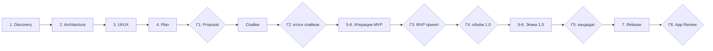

# Product Proposal — Часть 4. Roadmap, риски, рекомендации

> Одобрено на гейте Г1 ([ADR 0001](../adr/0001-adopt-proposal-architecture.md)); черновик от 27.10.2026. Название — **Carrel** ([часть 1](01-product.md#1-название-приложения-и-альтернативы)), так же называются таргет и пакет (`Carrel`, `CarrelKit`). Идентификаторы (bundle ID `dev.devlet.notebook`, UTType, iCloud-контейнер) от названия не зависят и не меняются никогда ([раздел 9](03-architecture.md#9-структура-проекта)).
>
> Метки релизов те же, что в части 1: **MVP**, **1.0**, **Future**; первым из Future выходит 1.1 с необязательным ИИ. Минимальная система всех релизов — iPadOS 27. Оценки даны в днях сфокусированной работы одного разработчика. Календарный срок зависит от того, сколько таких дней в неделе есть у владельца.

## 10. Roadmap разработки

### 10.1 Этапы работы

| Этап | Результат | Где лежит | Гейт |
|---|---|---|---|
| 1. Product Discovery | Название, концепция, сценарии, функции с приоритетами, состав MVP и 1.0, преимущества | [Часть 1](01-product.md), `01-product.md` | Г1 |
| 2. Product Architecture | Стек, слои и модули, ADR, модель данных, бюджеты производительности, тестирование, структура проекта, CI | [Часть 3](03-architecture.md), `03-architecture.md` | Г1 |
| 3. UI/UX | Три настроения с макетами, рекомендация, ключевые экраны и принципы движения | [Часть 2](02-design.md), `02-design.md` | Г1 |
| 4. Implementation Plan | Итерации MVP, эпики 1.0, процесс, риски, монетизация | Часть 4, этот документ | Г1 |
| 5. Development | Код по итерациям, отчёты спайков в `docs/spikes/`, решения в `docs/adr/`, `CHANGELOG.md` | Репозиторий | Г2, Г3 |
| 6. Quality Assurance | Ручной чек-лист [8.8](03-architecture.md#88-стратегия-тестирования), замеры бюджетов [8.5](03-architecture.md#85-производительность-и-бюджеты) на iPad Air, учения по сбоям из [8.6](03-architecture.md#86-надёжность-данных), бета с 5–10 студентами | Issue релиза, `docs/performance.md`, TestFlight | Г5 |
| 7. Release Preparation | Запись в App Store Connect, метаданные, скриншоты, политика конфиденциальности, ответы App Privacy и age rating, заметки для App Review | App Store Connect, сайт | Г6 |

Номера этапов идут в порядке работы, а номера частей — в порядке чтения: архитектура (этап 2) лежит в части 3, дизайн (этап 3) — в части 2. Этапы 1–4 закрывает этот Proposal. Код не пишется до Г1: архитектура и план без утверждённого объёма продукта меняются слишком дорого. Этапы 5–7 повторяются для каждого релиза. MVP проходит 5 и 6 (в App Store он не выходит), 1.0 — все три. QA не откладывается на конец: у каждой итерации есть свои критерии ([10.2](#102-итерации-mvp)), а этап 6 — это приёмка релиза целиком.



| Гейт | Что решаем | Кто и на чём основании |
|---|---|---|
| Г1. Proposal одобрен | Рабочее имя, настроение интерфейса, объём и критерий MVP, ответы на открытые вопросы из списка ниже | Владелец, по документам |
| Г2. Итоги спайков | Режим зума; подтверждённое окно потерь (5 с) и дневной объём записи на диск; правила для времени и ID штрихов; язык поиска по рукописи — русский и английский или только английский. Каждое решение оформляется ADR | Владелец, по отчётам с цифрами |
| Г3. MVP принят | Две недели лекций только в приложении без возврата в Goodnotes (критерий из [4.12](01-product.md#412-состав-mvp)) | Владелец, по собственному опыту |
| Г4. Объём 1.0 зафиксирован | Итоги интервью со студентами; вступление в Developer Program; порядок сокращения из [4.13](01-product.md#413-состав-10) | Владелец |
| Г5. Релиз-кандидат | Чек-лист [8.8](03-architecture.md#88-стратегия-тестирования) пройден, бюджеты [8.5](03-architecture.md#85-производительность-и-бюджеты) выполнены, бета закрыта без блокеров, синхронизация отработала внутреннюю обкатку | Владелец, по отчёту QA |
| Г6. Отправка на ревью | Метаданные, приватность, age rating, заметки для App Review | Владелец |

**Что нужно от владельца для Г1.** Минимальная iPadOS 27, держатель копирайта («Devlet Boltaev») и идентификаторы `dev.devlet.notebook` уже решены и на Г1 не обсуждаются. Открытыми остаются:

1. Рабочее имя: Carrel или Sheaf ([1.5](01-product.md#15-выбор)).
2. Настроение интерфейса из [6.2](02-design.md#62-настроения); рекомендуем Reading Room.
3. Объём MVP и критерий готовности из [4.12](01-product.md#412-состав-mvp): две недели лекций без возврата в Goodnotes.
4. Выпрямление фигур в MVP с решением go/no-go после первого дня И12; при «нет» фигуры уходят в 1.0, а в MVP остаётся линейка.
5. Принцип монетизации: ядро бесплатно навсегда и без подписки ([12.3](#123-монетизация-варианты)).
6. Разделение лицензий: код под MIT, брендовая графика — под отдельной лицензией «все права защищены» ([12.4](#124-бренд-вне-mit)).
7. Срок вступления в Developer Program; рекомендуем сразу после Г3 ([10.3](#103-релиз-10)).
8. Сколько сфокусированных дней в неделю уходит на проект: от этого зависит весь календарь.
9. Второе устройство для проверки синхронизации к Г4: второй iPad, Mac или устройство студента из беты.
10. Оборудование: Mac на Apple silicon с macOS Tahoe 26.6 или новее (иначе Xcode 27 не запустится) и iPad Air с Pencil Pro, обновлённый до iPadOS 27 (на нём идут все спайки).
11. Текстовые блоки остаются в Future, а не в MVP или 1.0 ([4.14](01-product.md#414-будущие-релизы)).
12. Тетради хранятся в приватной папке приложения (`Application Support`) и в «Файлах» не видны; наружу они выходят только явным экспортом и резервной копией.

### 10.2 Итерации MVP

Правила плана:

- **Сначала риск.** Всё, что может перечеркнуть архитектуру (PencilKit на 60 Гц, сохранность при сбое, русский в `PKStrokeRecognizer`), проверяется спайками до продуктовых экранов. Если провал случится, то в первую неделю, а не в последнюю.
- **Каждая итерация оставляет `main` рабочим** и устанавливаемым на iPad. Наполовину готовая функция прячется за Debug-флагом, а не живёт в ветке.
- **Атмосфера внутри каждой итерации.** Токены цвета, типографики и движения появляются в И1, и каждый новый экран сразу делается в выбранном настроении. «Полировки в конце» нет.
- **Резерв на редактор.** К итерациям редактора (И8–И14) добавлен резерв 30%, округлённый до ближайшего целого дня, но не меньше одного дня. Оценки PencilKit-редактора до спайков ненадёжнее остальных: пул канвасов, жесты и undo чаще всего оказываются сложнее, чем выглядят. Неизрасходованный резерв не растягивает итерацию, а переходит к следующей итерации редактора.
- **Одна итерация — один GitHub issue** с объёмом и чек-листом общих критериев, в milestone `MVP`.
- Часть изменений готовится без Mac; сборку и тесты таких изменений подтверждает CI. Всё, что требует устройства, проверяет владелец по ручному чек-листу.

**Общие критерии готовности** действуют для каждой итерации. В описаниях ниже перечислено только то, что к ним добавляется.

| Критерий | Как проверяем |
|---|---|
| CI зелёный | `lint.yml` на `ubuntu-24.04` и `ci.yml` на `xcode-27` для последнего коммита итерации |
| Новая логика покрыта тестами | Swift Testing в `CarrelKit` (`swift test`) или в `CarrelTests` для адаптеров |
| Ключевой сценарий покрыт UI-тестом | XCTest в плане `UI`, хотя бы один зелёный прогон `nightly.yml` |
| Ручная проверка на устройстве | Пункты чек-листа [8.8](03-architecture.md#88-стратегия-тестирования), которые затрагивает итерация, на iPad Air + Pencil Pro; короткая запись экрана в issue |
| Доступность | VoiceOver-метки у новых элементов, Dynamic Type, вариант для Reduce Motion у каждой новой анимации, Increase Contrast |
| Нет сценария потери данных | Если итерация трогает данные: прерывание посреди операции проверено тестом или руками, ни один путь не удаляет файлы пользователя мимо Корзины (Trash) |
| Документация | Строки в String Catalog, запись в `CHANGELOG.md` (`Unreleased`), ADR для нетривиального решения |

| № | Итерация | Дней | Риск или боль, которую закрывает |
|---|---|---|---|
| И0 | Фундамент репозитория и инструментов | 2–3 | Хаос в процессе, сборка «только у автора» |
| И1 | Walking skeleton | 2–3 | Нестыковки слоёв, CI без реального кода |
| И2 | Спайк S1: задержка, зум, пул канвасов | 3 | Главный технический риск (ADR-05) |
| И3 | Спайк S6: сохранность и объём записи; S3: время и ID штрихов | 3 | Потеря данных, износ флеш-памяти; точность будущего аудио и слияния |
| И4 | Спайк S2: рукопись на русском | 2 | Обещание поиска по рукописи |
| И5 | Хранилище тетради | 4 | Потеря данных |
| И6 | Библиотека и организация | 3 | Слабая организация |
| И7 | Снимки, резервная копия и настройки | 4 | Потеря данных при удалении приложения |
| И8 | Редактор: прокрутка и пул канвасов | 4 + 1 | Скорость на больших тетрадях |
| И9 | Перья и палитра | 3 + 1 | Перегруженный интерфейс |
| И10 | Отмена, лассо, линейка | 2 + 1 | Потеря истории правок при подмене канваса |
| И11 | Apple Pencil Pro и политика ввода | 2 + 1 | Меню вместо инструмента под рукой |
| И12 | Выпрямление фигур | 3 + 1 | Собственная надстройка над PencilKit |
| И13 | Бумага и страницы | 3 + 1 | Потеря страницы при переносе |
| И14 | Изображения | 2–3 + 1 | Рост памяти и размера тетради |
| И15 | Экспорт | 2 | Данные заперты в приложении |
| И16 | Поиск по названиям и «Quick Note» | 2 | Слабый поиск |
| И17 | Обложки, открытие тетради и первый запуск | 4–5 | Непривлекательный интерфейс, пустой экран при первом запуске |
| И18 | Доступность и система | 2–3 | Приложение недоступно части пользователей |
| И19 | Производительность и учения по сбоям | 3 | Бюджеты без замеров |
| И20 | Обкатка MVP | 2 недели | Критерий MVP |

Запись «4 + 1» — оценка плюс резерв итерации редактора. Итого 62–67 дней сфокусированной работы, из них 7 дней резерва, плюс две недели обкатки. При трёх таких днях в неделю это около пяти месяцев до начала обкатки. Окна, каталог с полнотекстовым поиском, Cover Studio и бумага Linen и Night в MVP не входят и запланированы в 1.0. Если выпрямление фигур не пройдёт гейт первого дня, MVP короче на 3 дня. Это оценка до спайков; после Г2 план пересчитывается.

#### И0. Фундамент репозитория и инструментов

- **Цель.** Любой разработчик за 10 минут клонирует репозиторий, собирает пустое приложение и понимает правила. CI ловит ошибки раньше, чем сборка попадёт на iPad.
- **Объём.**
  - Владелец создаёт в Xcode 27 пустой проект `Carrel` (iPad, deployment target iPadOS 27.0) — около 5 минут на Mac. Дальше всё правится как текст: folder-synchronized groups, `Config/*.xcconfig`, Info.plist и entitlements в `Config/`, пакет `Packages/CarrelKit` с пустыми `NotebookDomain`, `NotebookData` и их тестами. Раскладка файлов — строго по дереву [раздела 9](03-architecture.md#9-структура-проекта): это единственный источник структуры репозитория, и новые файлы появляются сначала там.
  - Разные bundle ID для Debug (`dev.devlet.notebook.dev`) и Release (`dev.devlet.notebook`), заданные в `Carrel.xcconfig`. У двух сборок раздельные данные, поэтому отладка никогда не трогает настоящие конспекты. Отдельных приложений для спайков не заводим: у бесплатной команды число приложений на устройстве ограничено (лимит не проверен, уточняем при настройке).
  - Workflows `lint.yml`, `ci.yml`, `nightly.yml`; `Scripts/lint.sh` и `Scripts/test.sh`; `.swift-format` в корне и отдельный для тестовых таргетов; `.githooks/commit-msg`, `.gitattributes`; тест-планы `Unit`, `UI`, `Sanitizers`. Метку раннера `xcode-27` подтверждаем здесь же: на момент исследования образ был в public preview. Запасной вариант — образ macOS с установленным Xcode 27, выбранным через `xcode-select`.
  - Документы: `README.md` (что это, тулчейн, как запустить), `CONTRIBUTING.md` (тулчейн, хук, команды, правила из [10.5](#105-процесс-разработки)), `CHANGELOG.md`, `ARCHITECTURE.md` (карта слоёв и модулей на одну страницу со ссылками на часть 3), `SECURITY.md`, `docs/adr/` с шаблоном и `0001-adopt-proposal-architecture.md`, который принимает все ADR части 3. Шаблоны issue и PR, `CODEOWNERS`, `dependabot.yml`.
  - Настройки GitHub: ruleset на `main`, запрещающий force push и удаление; secret scanning с push protection; Dependabot alerts; приватные сообщения об уязвимостях.
- **Готово, когда:** пустое приложение собирается в CI и ставится на iPad из Xcode; `swift test` пакета проходит; на ветке `spike/ci-selfcheck` при ручном запуске lint падает на неотформатированном файле и на сообщении коммита не по формату (после проверки ветка удаляется); инструкция из README воспроизводится на чистом клоне.

#### И1. Walking skeleton

- **Цель.** Тонкий сквозной путь через все слои: библиотека → новая тетрадь → письмо → сохранение в пакет → перезапуск → штрихи на месте.
- **Объём.** `CarrelApp`, `AppDependencies`, `AppDirectories` с `.temporary()`; минимальные `Notebook`, `Page`, `InkData`; `NotebookPackage` и `NotebookStore.saveInk` с настоящей атомарной заменой; библиотека простым списком; одна страница с `PKCanvasView` в `NotebookCanvasViewController`, `maximumSupportedContentVersion = .version5` (уровень iPadOS 27); сохранение на `.inactive`; первые токены `DesignSystem` из выбранного настроения; `Localizable.xcstrings`; `PrivacyInfo.xcprivacy` с `NSPrivacyTracking = false`.
- **Готово, когда:** UI-тест «создать тетрадь → штрих пальцем (Debug `.anyInput`) → перезапуск → штрих на месте» зелёный; на iPad штрихи Pencil Pro переживают закрытие из переключателя приложений; round-trip пакета покрыт тестом в `NotebookDataTests`. Этой сборкой владелец пишет эталонные страницы для И4.

#### И2. Спайк S1: задержка, зум и пул канвасов

- **Цель.** До продуктовых экранов узнать, выдерживает ли PencilKit наш редактор на iPad Air 60 Гц. Это главный технический риск проекта (ADR-05).
- **Объём.** Ветка `spike/s1-canvas-zoom`. Первым делом, в первый час на устройстве, — `PKStrokeRecognizer.supportedLanguages` на iPad владельца: есть ли в списке русский. Ответ сразу идёт в отчёт S2: от него зависят обещание из [5.6](01-product.md#56-русский-и-английский-в-одном-поиске) и позиционирование, а качество распознавания меряет И4. Дальше — сам S1: нагрузочная тетрадь на 300 плотных страниц из Debug-команды; зум через раскладку против постраничного режима; пул из трёх канвасов с подменой превью; подавление встроенного undo PencilKit и снимки `PKDrawing` для `UndoManager` (ADR-06); съёмка письма на 240 fps рядом с Apple Notes. Заодно две проверки ввода: как наши касания двумя и тремя пальцами выигрывают у `drawingGestureRecognizer` в режиме `.anyInput` и какую задержку это даёт первому штриху пальцем; даёт ли линейка PencilKit отклик Pencil Pro сама.
- **Готово, когда:** в `docs/spikes/s1-canvas-zoom.md` есть цифры по критериям S1: чёткость на 1–4x, нет мерцания при письме, 0 hitches при смене страниц, задержка на уровне Apple Notes, память undo-снимков. Режим зума выбран и записан в ADR. Ответ про русский в `supportedLanguages` записан. Код спайка в `main` не вливается: production-версия пишется в И8 с тестами.
- **Стоп-сигнал.** Если не проходит ни один режим, Г2 наступает досрочно, и владелец выбирает между постраничным режимом, сокращением объёма и собственным движком чернил.

#### И3. Спайк S6: сохранность и объём записи, S3: время и ID штрихов

- **Цель.** Подтвердить на устройстве обещание из [2.2](01-product.md#22-принципы) до того, как на нём построено всё остальное: если приложение упадёт, теряется не больше 5 секунд непрерывного письма, обычно — ничего; при сворачивании, переключении приложений и закрытии из переключателя не теряется ничего. S6 описан в таблице спайков [8.3](03-architecture.md#83-ключевые-архитектурные-решения).
- **Объём.**
  - Прототип `AutosavePolicy`: запись после 2 с покоя и не позже `maximumDelay` 5 с от первого несохранённого изменения; немедленный сброс на `.inactive` и `.background`, при смене страницы, закрытии тетради и memory warning, каждый под `beginBackgroundTask`. Запись пропускается, если хэш закодированных данных совпал с последним записанным.
  - `replaceItemAt` с `.previous` на реальном томе iPad. Завершение процесса в случайный момент: остановка из Xcode, закрытие из переключателя, Debug-команда `abort()` между шагами замены файла. Атомарность `replaceItemAt` не принимаем на веру: комментарий о ней в коде остаётся только со ссылкой на отчёт S6, где её подтвердило прерывание между шагами.
  - Замеры: кодирование и запись страницы на 500 КБ (≤ 30 мс вне main); дневной объём записи. Для него Debug-команда 6 часов проигрывает записанные штрихи в темпе лекции, signpost считает байты, а итог сверяется с диагностикой записи на диск в MetricKit (`MetricManager`) за этот день. Бюджет — ≤ 500 МБ за 6-часовой учебный день вместе со снимками, миниатюрами и манифестами.
  - S3 на iPadOS 27: сохраняется ли `PKStrokePath.creationDate` после лассо, точечного ластика, копирования и вставки; переживает ли `PKStroke.id` round-trip через `dataRepresentation()` с потолком `.version5` и перемещение лассо.
- **Готово, когда:** 50 случайных прерываний не дали ни одной повреждённой страницы, потеря ни разу не превысила 5 с, а после сворачивания и закрытия из переключателя потерь нет; дневной объём записи укладывается в 500 МБ. Если не укладывается, `maximumDelay` для очень больших страниц растёт адаптивно, но не выше 10 с, и обещание из 2.2 переписывается с новым числом. Цифры — в `docs/spikes/s6-crash-safe-saving.md` и `docs/spikes/s3-stroke-identity.md`. Если даты штрихов меняются, правило их восстановления записано в ADR, дополняющий ADR-09. Если ID не переживают round-trip, тот же ADR фиксирует, что слияние штрихов по `PKStroke.id` (1.x) требует своего ключа.

#### И4. Спайк S2: рукопись на русском

- **Цель.** Узнать, ищется ли рукопись на русском, раньше, чем мы это пообещаем ([4.7](01-product.md#47-поиск), [5.6](01-product.md#56-русский-и-английский-в-одном-поиске)). Сама функция выходит в 1.0, но от ответа зависит позиционирование. Есть ли русский в `PKStrokeRecognizer.supportedLanguages`, уже известно из И2; здесь меряем качество.
- **Объём.** Эталонный набор: около 20 страниц настоящих конспектов владельца на русском, английском и смешанных строках, с формулами, примерно 1000 размеченных слов. Прогон `PKStrokeRecognizer` — только на iPad, потому что симулятор распознаёт только латиницу. Метрика — доля слов, найденных по `indexableContent` и через `search(_:fullWordsOnly:caseMatchingOnly:)` с поиском по префиксу, отдельно для RU, EN и формул. Заодно проверяем, пишется ли русский запрос пером через Scribble в поле поиска. Сами страницы в публичный репозиторий не попадают, только цифры.
- **Порог.** Предлагаем не меньше 80% найденных слов для RU и EN на почерке владельца; уточняем после первого прогона.
- **Готово, когда:** отчёт `docs/spikes/s2-handwriting-recognition.md` готов, и на Г2 выбран один из двух исходов. (а) Русский есть в `supportedLanguages` и проходит порог — поиск по рукописи на русском и английском остаётся в 1.0. (б) Русского нет или он не проходит порог — рукопись в 1.0 ищется только на английском, пока Apple не добавит русский; пункт 5.6 снимается, а названия, теги и текст PDF ищутся на обоих языках. Второго движка через Vision нет ни в одном исходе: его качество на рукописной кириллице не документировано, а второй путь удвоил бы индексацию и тесты. Минимальная iPadOS 27 остаётся при любом исходе: её требуют и другие API (ID штрихов, выделение, `MetricManager`).

#### И5. Хранилище тетради

- **Цель.** Production-версия ADR-02 и [ADR-03](03-architecture.md#adr-03-атомарная-запись-и-автосохранение) по итогам S6.
- **Объём.**
  - `InkEnvelope` (magic, версии, `requiredContentVersion`, длина, SHA-256); актор `NotebookStore`; `EditorSession` с `AutosavePolicy` из S6 (2 с покоя, `maximumDelay` 5 с, немедленный сброс под `beginBackgroundTask`, пропуск записи при совпадении хэша).
  - Манифест первым: запись о странице попадает в `notebook.json` раньше первого сохранения её чернил, в том же сбросе. Манифест хранит `hasInk` и `inkHash` каждой страницы. Страница считается пустой только при `hasInk == false`.
  - Цепочка восстановления `.ink` → `.ink.previous` → снимок → `Recovered/`. Она запускается и тогда, когда `.ink` нет при `hasInk == true` или лежит одинокий `.ink.previous`. Файл `ink/*.ink` без записи в манифесте подхватывается при загрузке как восстановленная страница в конце тетради. Восстановление никогда не удаляет файлы.
  - Страница с `requiredContentVersion` новее `.version5` — это не порча: она открывается только для чтения, а её файл не меняется.
  - `notebook.json` схемы v1 ([8.4](03-architecture.md#84-модель-данных)): PDF-фон страницы, записи звука, `tagIDs`, `hasInk` и `inkHash` у страницы, `isFavorite` у тетради; golden-фикстура v1. `NotebookStoreError` и `UserFacingIssue`.
  - Индикатор сохранения по настоящему состоянию: `Saved` (несохранённого нет) → `Edited` (тихая надпись, пока самое старое изменение моложе 7 с) → `Saving…` (запись задержалась) → `Not saved` (ошибка записи с причиной и действием).
- **Готово, когда:** параметризованный тест порчи `InkCorruption` (усечение, бит-флип, пустой файл, чужой magic) зелёный: каждая порча откатывает страницу к `.previous`. Отдельный тест: `requiredContentVersion` новее поддерживаемой даёт `.requiresNewerSystem`, страница открыта только для чтения, а файл после попытки правки байт-в-байт прежний. Тесты на сироту `ink/*.ink` и на пропавший `.ink` при `hasInk == true`; тест, что `Saved` не показывается, пока что-то не записано; UI-тест с `terminate()` внутри окна автосохранения; пункт 8 ручного чек-листа пройден.

#### И6. Библиотека и организация

- **Цель.** Структура «семестр → курс → тетради» и удаление, которое нельзя сделать по ошибке.
- **Объём.** `LibraryStore` и `library.json`; вложенные папки с цветом; `SortKey`; сортировка по дате изменения, названию и дате создания; недавние и избранные (`isFavorite`); переименовать, дублировать, переместить; мягкое удаление и Корзина с разделами Notebooks и Pages, срок фиксирован — 30 дней, без настройки; «Inbox» с фиксированным UUID; индекс названий в памяти, собранный из сводок манифестов. SQLite-каталог с полнотекстовым поиском в MVP не нужен: несколько сотен названий ищутся в памяти быстрее, чем открывается база; каталог появляется в 1.0 (Э6). Сетка обложек пока с простыми цветными обложками.
- **Готово, когда:** UI-тест «папка → тетрадь → удалить → восстановить из Trash»; тест: индекс в памяти после перезапуска совпадает с манифестами пакетов; очистка Корзины — чистая функция с параметром `now`, и тест подтверждает, что до 30 дней файлы не трогаются; VoiceOver озвучивает название и дату тетради.

#### И7. Снимки, резервная копия и настройки

- **Цель.** Три уровня отката у каждой страницы, копия вне приложения, из которой можно восстановиться, и экран настроек, где всё это живёт.
- **Объём.**
  - Снимки — APFS-клоны пакета: последние 5 сеансов редактирования и по снимку в день, дневные хранятся 30 дней (ADR-04). `isExcludedFromBackup` для `Snapshots/` и производных кэшей.
  - Резервная копия библиотеки — один файл Apple Archive (`.aar`, сжатие lzfse), который пишет и читает системный фреймворк `AppleArchive`; сохраняется в «Файлы» через системный выбор места, перед записью проверяется свободное место. ZIP, `NSFileCoordinator` с `.forUploading` и сторонние библиотеки не используем: публичного API распаковки ZIP на iOS нет, а `AppleArchive` потоково пишет и читает в обе стороны.
  - Восстановление в MVP: Settings › Data › Restore from Backup… — системный выбор файла `.aar`, подтверждение с датой копии и числом тетрадей. Текущая библиотека сначала целиком уходит в `Recovered/`, затем подменяется содержимым копии. Импорт отдельной тетради из архива — в 1.0 (Э4). Причина: копия, из которой нельзя восстановиться, не защищает, а до вступления в Developer Program удаление приложения стирает данные.
  - Экран Settings по [6.5](02-design.md#настройки): Data (статус сохранения, Back Up Now, Restore from Backup…, время последней копии), Library (сортировка), About (версия, лицензии, исходный код на GitHub, «No Tracking»), каркас Appearance и Writing. Пункты остальных разделов добавляют итерации, которым они принадлежат: сторону палитры — И9, выпрямление фигур — И12, тему и Paper Texture — И17.
- **Готово, когда:** тест ротации снимков (чистая функция с параметром `now`); round-trip тест в пакете: библиотека → `.aar` → восстановление во временную папку → пакеты и `library.json` совпадают побайтно, а прежняя библиотека лежит в `Recovered/`; тест нехватки места: копия не начинается и называет причину; учение на iPad: копия → удалить приложение → установить заново → Restore from Backup… → все тетради открываются. Учение повторяется перед Г3.

#### И8. Редактор: прокрутка и пул канвасов

- **Цель.** Production-редактор по итогам S1: скорость не зависит от длины тетради.
- **Объём.** `NotebookCanvasViewController` с вертикальной прокруткой и пулом не больше трёх `PKCanvasView`; превью невидимых страниц и предекодирование соседней; масштаб пальцами и уровни «по ширине» и «страница целиком» по ADR из S1; открытие на последнем месте — последняя страница и масштаб хранятся вне пакета, в `Application Support`, и не синхронизируются; переход к странице по номеру; новая страница из пунктирного контура под последней: первый штрих превращает контур в страницу, под пером ничего не сдвигается, проявляются только заливка и тень; `ThumbnailRenderer`. Приложение работает в одной сцене (`UIApplicationSupportsMultipleScenes = NO`), размер окна при этом меняется свободно. Окна на тетрадь и `EditorSessionRegistry` — в 1.0 (Э10).
- **Готово, когда:** на нагрузочной тетради нет пустых страниц при быстром листании (пункты 6–7 чек-листа); интервал `notebook.open` укладывается в бюджет [8.5](03-architecture.md#85-производительность-и-бюджеты); UI-тест открытия на последнем месте; тест: запись о новой странице попадает в манифест раньше её чернил.

#### И9. Перья и палитра

- **Цель.** Спокойная палитра письма: нужное перо — одним касанием, на бумаге — ни одного элемента управления.
- **Объём.** Ручка, монолиния, перьевая ручка, карандаш и Highlighter (маркеры Yellow, Blue, Pink, Mint); ровно три избранных пера в палитре; повторное касание выбранного инструмента открывает его настройки — толщину и цвет, включая свой цвет через системный `ColorPicker`; один жест для всех инструментов, включая ластик; палитры цветов, включая набор «Учёба»; ластик по штрихам и точечный; палитра не больше семи элементов; сторона палитры для левой руки (пункт в Settings › Writing). Liquid Glass — только у плавающих элементов; во время письма в покое над бумагой стекла нет. Предпросмотр при наведении — 1.0 (Э9).
- **Готово, когда:** на скриншоте редактора iPad Air 11" в альбомной ориентации на бумаге нет ни одного элемента управления, элементы управления занимают не больше 8% площади окна, а в масштабе «по ширине» бумага занимает всю ширину между полями стола (принцип 1 из [6.1](02-design.md#61-принципы-дизайна)); инструменты доступны с клавиатуры и через VoiceOver; выбранное перо и свои цвета переживают перезапуск.

#### И10. Отмена, лассо, линейка

- **Цель.** Ошибаться без страха и править компоновку без переписывания.
- **Объём.** `UndoManager` на сеанс (ADR-06); касание двумя пальцами — отмена, тремя — повтор; ⌘Z и ⇧⌘Z; кнопки на панели; встроенное лассо PencilKit как есть (переместить, масштабировать, копировать, удалить), смена цвета выделенного — в 1.0 (Э8); линейка; правило ADR-09: любое программное преобразование штриха сохраняет исходную `creationDate`.
- **Готово, когда:** тест подтверждает, что отмена работает после переиспользования канваса из пула; тест сохранения `creationDate` при преобразовании; жесты проверены вручную на iPad.

#### И11. Apple Pencil Pro и политика ввода

- **Цель.** Сменить инструмент, не отводя взгляд от строки, и не путать палец с пером.
- **Объём.**
  - `drawingPolicy` выставляется явно из `UIPencilInteraction.prefersPencilOnlyDrawing` (`.pencilOnly` или `.anyInput`) и перечитывается при каждой активации сцены: уведомления об изменении настройки в документации нет. `.default` не используем: без видимого `PKToolPicker` он принимает только Apple Pencil, а палитра у нас своя.
  - Вторая таблица жестов для `.anyInput` по [6.6](02-design.md#66-apple-pencil-и-жесты): один палец пишет, прокрутка — двумя пальцами, двойной тап и долгое нажатие на холсте отключены, касания двумя и тремя пальцами (отмена и повтор) выигрывают у `drawingGestureRecognizer` способом, который выбрал S1.
  - Сжатие открывает палитру у кончика пера с учётом системной настройки; без `hoverPose` палитра появляется у последней точки штриха, а без штрихов в сеансе — рядом с основной палитрой. Касание пером, которое закрывает палитру, поглощается и не рисует. Двойное касание; barrel roll; Apple Pencil 2 и Apple Pencil (USB-C) без функций, которых у них нет.
  - Тактильный отклик — только на события приложения (выпрямление фигуры в И12). Для линейки PencilKit свой отклик не вызываем: API не сообщает момент прилипания, а угадывание дало бы двойной или ложный щелчок.
- **Готово, когда:** пункты 2, 3 и 5 ручного чек-листа пройдены в обоих значениях системной настройки «Only Draw with Apple Pencil»; закрытие палитры касанием пера не оставляет точки; с Reduce Motion палитра появляется без движения.

#### И12. Выпрямление фигур

- **Цель.** Аккуратные схемы и графики по удержанию пера. Это единственная крупная собственная надстройка над PencilKit в MVP, и у PencilKit нет для неё публичного API.
- **Объём.** Распознавание удержания в конце штриха; подбор линии, стрелки, прямоугольника или эллипса; замена штриха построенным `PKStroke` с исходной `creationDate`; отмена возвращает исходный штрих; отклик Pencil Pro через `UICanvasFeedbackGenerator` (`pathCompleted`); переключатель выпрямления в Settings › Writing.
- **Гейт внутри итерации.** Если после первого дня ложные срабатывания или задержка заметны на 60 Гц, фигуры переходят в 1.0 (Э8), а в MVP остаётся линейка. Оставшиеся 3 дня итерации вычитаются из плана.
- **Готово, когда:** классификатор покрыт тестами на записанных штрихах-фикстурах; не больше одного ложного срабатывания на 50 обычных штрихов; на iPad владелец рисует схему и график, и выпрямление срабатывает только там, где его ждали.

#### И13. Бумага и страницы

- **Цель.** Управлять тетрадью как бумажной: своя бумага, порядок страниц, разбор «Inbox».
- **Объём.** Чистая, линейка узкая и широкая, линейка с полем (Ruled with Margin, бумага по умолчанию, токен `marginLine`), клетка 5 мм, точки — в тонах White и Cream (Linen и Night — в 1.0, Э9); A4 и Letter, книжная и альбомная; смена бумаги у страницы и у тетради; в сетке миниатюр — добавить, удалить, дублировать, переставить; удалённая страница попадает в раздел Pages в Trash и оттуда восстанавливается; переместить или скопировать страницу в другую тетрадь, включая «Inbox».
- **Готово, когда:** UI-тест операций со страницами, включая восстановление удалённой страницы из Trash; перенос между тетрадями идёт в порядке «записать в целевую → мягко удалить в исходной», и тест подтверждает, что сбой посередине даёт дубликат, а не потерю; цвета чернил читаются на White и Cream и с Increase Contrast.

#### И14. Изображения

- **Цель.** Фото доски и схема из учебника прямо в конспекте без роста памяти.
- **Объём.** Вставка из «Фото» (`PHPickerViewController`, без запроса доступа к медиатеке), «Файлов», камеры, буфера обмена и перетаскиванием; HEIC-ассеты по SHA-256 с длинной стороной до 4096 px (ADR-07); касание пальцем по изображению выделяет его; перемещение, масштаб, поворот; слой под чернилами; `NSCameraUsageDescription` в `InfoPlist.xcstrings`.
- **Готово, когда:** тест подтверждает, что дубликат изображения не занимает места; очистка неиспользуемых ассетов учитывает страницы в Trash; 20 изображений на странице не дают hitches при письме.

#### И15. Экспорт

- **Цель.** Конспект можно сдать, отправить и распечатать; данные не заперты в приложении.
- **Объём.** PDF тетради, страницы и диапазона, с бумагой или без; изображение страницы; системный лист «Поделиться». Вектор или растр выбираем по замеру качества и размера файла.
- **Готово, когда:** экспорт тетради на 300 страниц идёт в фоне, отменяется и не блокирует письмо; тест подтверждает, что экспорт не меняет пакет; результат открывается в «Файлах» и печатается.

#### И16. Поиск по названиям и «Quick Note»

- **Цель.** Найти тетрадь за секунду и записать мысль за две.
- **Объём.** Поиск по индексу названий тетрадей и папок в памяти (из И6) с нормализацией регистра, диакритики и `ё → е`; экран поиска; «Quick Note» в библиотеке открывает новую страницу в «Inbox» сразу в режиме письма; команды меню и сочетания клавиш для новых действий. SQLite-каталог с FTS и спайк S5 — в 1.0 (Э6).
- **Готово, когда:** тесты нормализации; UI-тест поиска; первые результаты не дольше 150 мс на синтетической библиотеке из 1000 тетрадей (performance-тест в пакете).

#### И17. Обложки, открытие тетради и первый запуск

- **Цель.** Моменты, которые владелец видит каждый день и по которым судит об атмосфере: полка с обложками, открытие тетради и первые секунды в приложении.
- **Объём.**
  - 12 готовых обложек — подобранные сочетания материала, цвета и этикетки, одинаковые во всех настроениях — в листе новой тетради, без Customize… (Cover Studio — в 1.0, Э9). Переход «обложка → страница» и обратно. Тема System/Light/Dark и Paper Texture в Settings › Appearance. Для каждой анимации — вариант Reduce Motion, для стекла — Reduce Transparency.
  - Первый запуск по [6.5](02-design.md#первый-запуск): библиотека с одной обложкой «Inbox», без входа в аккаунт, карусели обучения и запросов разрешений. Подсказки TipKit — по одной и в контексте; первая, про сжатие Pencil Pro, появляется после первой минуты письма и больше не возвращается.
  - Рукописные пустые состояния: пустые папка, Favorites, Trash и поиск без результатов. Иллюстрации владелец рисует пером в самом приложении, они хранятся как `PKDrawing` и при первом показе дописываются штрих за штрихом за 1.2 с; с Reduce Motion показываются целиком.
- **Готово, когда:** переходы держат 60 кадров/с на iPad Air по Animation Hitches в Instruments; с Reduce Motion движение заменено кроссфейдом; от первого запуска до первого штриха проходит меньше 10 секунд; подсказка TipKit не возвращается после перезапуска; каждое пустое состояние проверено в светлой и тёмной теме; запись экрана приложена к issue итерации.

#### И18. Доступность и система

- **Цель.** Приложение удобно с VoiceOver, крупным шрифтом, клавиатурой и в окне любого размера.
- **Объём.** Dynamic Type в библиотеке, меню и настройках; VoiceOver для библиотеки, навигации и инструментов; полный набор команд в строке меню; указатель и трекпад; окно любого размера и Stage Manager в одной сцене. Окна на тетрадь — в 1.0 (Э10).
- **Готово, когда:** `XCUIApplication.performAccessibilityAudit()` в UI-тестах ключевых экранов проходит без замечаний, и владелец делает ручной проход VoiceOver по библиотеке, редактору и настройкам; конфигурация с псевдолокализацией двойной длины проходит без обрезанных строк; пункты 10–11 ручного чек-листа в части MVP пройдены.

#### И19. Производительность и учения по сбоям

- **Цель.** Подтвердить цифрами и учениями обещания скорости и сохранности до того, как владелец доверит приложению лекции.
- **Объём.** Замеры всех бюджетов [8.5](03-architecture.md#85-производительность-и-бюджеты) на iPad Air с записью в `docs/performance.md`; performance-тесты XCTest (запуск, открытие 300 страниц, скролл, память); MetricKit (`MetricManager`) в локальный журнал, включая диагностику записи на диск, с отправкой через «Поделиться»; учения из [8.6](03-architecture.md#86-надёжность-данных): заполненный диск, повреждённый файл страницы и `notebook.json`, файл `ink/*.ink` без записи в манифесте, страница из более новой iPadOS, схема новее приложения.
- **Готово, когда:** каждый бюджет выполнен или на него есть issue с планом; каждый сценарий 8.6 воспроизведён и даёт описанную реакцию; час непрерывного письма без замедления и перегрева (пункт 15 чек-листа [8.8](03-architecture.md#88-стратегия-тестирования)).

#### И20. Обкатка MVP

- **Цель.** Критерий MVP из [4.12](01-product.md#412-состав-mvp).
- **Объём.** Владелец ведёт все лекции только в Release-сборке. Резервная копия — раз в неделю. Переустановка из Xcode — раз в 7 дней, пока профиль бесплатный; установка поверх данные сохраняет. Дисковую метрику MetricKit за лекционные дни сверяем с бюджетом 500 МБ в день. Каждый дефект — issue; исправления идут обычными коммитами в `main` и попадают на iPad только после зелёного CI.
- **Готово, когда:** две недели без возврата в Goodnotes и без единой потерянной страницы; нет открытых issue с метками `data-loss` и `blocker`; тег `v0.1.0` и запись в `CHANGELOG.md`. Это Г3.

### 10.3 Релиз 1.0

**Условия старта.** Г3 пройден. Вступление в Apple Developer Program рекомендуем сразу после Г3: без него нельзя разрабатывать синхронизацию на устройстве, запускать TestFlight и резервировать имя в App Store Connect, а синхронизации нужна долгая внутренняя обкатка. На Г4 объём фиксируется по итогам интервью с 5–10 студентами (лекционный макет, режим повторения, выключенный по умолчанию ИИ).

**Порядок эпиков** выбран так, чтобы самое рискованное началось рано, а обкатка синхронизации шла параллельно с остальной работой. «Сохранность+» идёт раньше синхронизации: до того как синхронизация впервые тронет данные, у пользователя должна быть независимая копия.

| Эпик | Итерации | Дней | Гейты и зависимости | Режется? |
|---|---|---|---|---|
| Э1. Организация | Теги на тетрадях и страницах (`tagIDs` есть в схеме v1 с MVP), поиск по тегам; архив семестра и вид списком | 5 | — | Нет |
| Э2. PDF | Импорт из «Файлов», «Поделиться» и перетаскиванием, копия в `assets/`; защищённый паролем PDF хранится разблокированной копией, исходный файл пользователя не меняется, и лист импорта об этом говорит; конвейер `CGPDFPage` в `CATiledLayer` с общим зумом (ADR-08) в новом таргете пакета `NotebookMedia` без изоляции по умолчанию: `draw(in:)` — `nonisolated` и читает только неизменяемое или защищённое блокировкой состояние; пометки и экспорт с прожжёнными чернилами; лекционный макет; извлечение текста и поиск по нему; вставка страниц PDF, свои шаблоны из PDF, переход с Goodnotes и Notability через PDF | 14 + 4 | PDF на 1000 страниц: первая страница ≤ 1 с, без пустых страниц при прокрутке (строка [8.5](03-architecture.md#85-производительность-и-бюджеты)); тест подтверждает, что хэш исходного файла не меняется; тест колбэка отрисовки на устройстве | Нет |
| Э3. Аудио | Спайк S4; запись сегментами CAF в фоне через `installAudioTap(onBus:bufferSize:format:tapProvider:)`, рекордер — в `NotebookMedia`; прерывания и смена наушников; индикатор уровня и предупреждение о тишине; «тапни штрих — услышь» (ADR-09): пока открыта полоса воспроизведения, `isDrawingEnabled = false`, и касание перематывает, а не рисует; воспроизведение с запасом `playbackPreroll` (5 с), скорость, перемотка; AAC после остановки; место на диске; при переносе или копировании страницы в другую тетрадь копируются метаданные и сегменты записи, на которые ссылаются её штрихи (клоны APFS) | 13 | S4: после аварийного завершения все сегменты воспроизводятся, потеря не больше 1 с; тест «перенести страницу → коснуться штриха → играет верный момент»; тест колбэка `installAudioTap` на устройстве; `NSMicrophoneUsageDescription`. Расшифровка аудио — не 1.0, а Future | Нет |
| Э4. Сохранность+ | История версий из снимков (страница или тетрадь); автокопия в выбранную папку; открытый документированный формат экспорта — архив `.aar` пакета тетради с метаданными и точками штрихов в JSON, спецификация в `docs/format/`; импорт тетради из архива | 7 | Формат экспорта читается тестом без PencilKit (JSON и точки штрихов) | Нет |
| Э5. Синхронизация iCloud | Модуль `NotebookSync`; `CKSyncEngine` поверх пакетов, зона на тетрадь, записи и `CKAsset`; метаданные — LWW по полям, членство в тегах у страниц и тетрадей — слияние множеств, где добавление побеждает; конфликт чернил страницы — всегда обе версии: локальная страница остаётся, присланная становится страницей «Conflicted copy» сразу за ней, слияния штрихов в 1.0 нет; зона удаляется только при окончательной очистке Trash, а входящие `zoneDeleted`, purge и `encryptedDataReset` никогда не удаляют локальные пакеты — тетрадь уходит в локальную Trash; квота и смена аккаунта; первая синхронизация большой библиотеки | 15 | Только после вступления в Developer Program; второе устройство; затем 4–6 недель внутренней обкатки на двух устройствах до Г5. Слияние штрихов по `PKStroke.id` — 1.x ([10.4](#104-будущие-релизы)) | Нет |
| Э6. Поиск и распознавание | Конкретный тип поверх `PKStrokeRecognizer` без протокола: второго движка нет; `SearchIndexer`; кэш `text/<pageID>.json` с `inkHash`, `recognitionVersion` и `indexableText` (из `indexableContent`), переиндексация при смене `PKStrokeRecognizer.recognitionVersion`; подсветка — живым `search(_:fullWordsOnly:caseMatchingOnly:)` по открытой странице, а не из кэша; поиск в тетради, копирование как текста; озвучивание распознанной рукописи в VoiceOver; Spotlight; спайк S5 и общий каталог `catalog.sqlite` с FTS5 вместо индекса названий в памяти | 13 | Язык рукописи — по исходу S2 на Г2: русский и английский или только английский. S5 — в первый день эпика; если FTS5 в системной SQLite нет, запасной путь фиксирует ADR до начала работ, а до тех пор работает индекс в памяти из MVP | Нет |
| Э7. Учёба | Лента и режим повторения; бумага Корнелла | 5 | — | Лента — да, последней из режущихся |
| Э8. Письмо, изображения, навигация | Художественные чернила; расширенное лассо для штрихов и изображений; смена цвета выделенного — своё плавающее действие рядом с выделением (`PKCanvasView.selection`, `canvasViewSelectionDidChange`), а не пункт системного меню; треугольники, многоугольники, таблицы; обрезка; сканирование документов (VisionKit); горизонтальное перелистывание; закладки | 10 + 3 | Если выпрямление фигур не прошло гейт И12, оно переезжает сюда (+4 дня) | Чернила и закладки — да |
| Э9. Pencil Pro и персонализация | Предпросмотр при наведении, свои действия; Cover Studio (материал, цвет, этикетка) и обложки из фото; бумага Linen и Night; настроения интерфейса; вечерняя теплота; атмосфера стола; альтернативные иконки | 15 | Настроения — из [6.2](02-design.md#62-настроения). Night включаем только после проверки пересчитанной палитры на устройстве: контраст не ниже 3:1 | Атмосфера стола и иконки — первыми |
| Э10. Система | Окно на тетрадь: `WindowGroup(for: Notebook.ID.self)` и `openWindow(value:)`; `EditorSessionRegistry` обеспечивает одно редактируемое представление на тетрадь: открытие уже открытой тетради переводит фокус на её окно; перетаскивание страниц наружу (`NSItemProvider` с PDF страницы); «Открыть в…» через `CFBundleDocumentTypes` без Share Extension (расширение потребовало бы App Group и `NSFileCoordinator`, см. [8.9](03-architecture.md#89-что-мы-сознательно-не-делаем)); Shortcuts и App Intents; «Quick Note» в Пункте управления — расширение WidgetKit с `ControlWidget`, чей intent открывает приложение | 12 | Расширение — новый таргет `dev.devlet.notebook.controls` в дереве [раздела 9](03-architecture.md#9-структура-проекта) со своей подписью; `perform` выполняется в процессе приложения, поэтому App Group и координация файлов не нужны. Одновременное редактирование одной тетради в двух окнах — вне объёма, только через отдельный ADR | Нет |
| Э11. Подготовка к App Store | См. ниже | 6 + бета | Developer Program; Xcode Cloud | Нет |

Итого около 122 дней сфокусированной работы, из них 7 — резерв эпиков редактора (Э2 и Э8, правило из [10.2](#102-итерации-mvp)); ещё 4 дня, если выпрямление фигур переедет из MVP. При трёх днях в неделю это около девяти месяцев после Г3. Для одного разработчика это много, и часть 1 это признаёт. Рост против плана MVP объясним: в 1.0 переехали окна, каталог с полнотекстовым поиском, Cover Studio и бумага Linen и Night. Порядок сокращения не меняется: атмосфера стола и иконки → художественные чернила → закладки → лента. PDF, аудио, синхронизация, история версий и поиск не режутся.

**Э11. Подготовка к App Store.**

- **Сразу после вступления в программу:** запись приложения в App Store Connect с bundle ID `dev.devlet.notebook` (резерв имени); проверка товарного знака по чек-листу [1.6](01-product.md#16-что-сделать-до-релиза) до финальной иконки; workflow Xcode Cloud по тегу `v*`. Запасной путь релиза — `xcodebuild` с ключом App Store Connect API в секретах GitHub; Fastlane не подключаем, пока без него можно обойтись.
- **Приватность:** аудит `PrivacyInfo.xcprivacy` (`CA92.1`, `C617.1`, `3B52.1`, `E174.1` — только реально вызываемые API); ответы App Privacy. Для 1.0 ожидаем «Data Not Collected»: аналитики и ИИ нет, синхронизация идёт через приватную базу CloudKit пользователя, к которой у нас нет доступа. Формулировку сверяем с правилами Apple перед отправкой. `ITSAppUsesNonExemptEncryption = NO`.
- **Обязательные страницы:** политика конфиденциальности и страница поддержки на поддомене `devlet.dev` (рабочий вариант — `carrel.devlet.dev`; GitHub Pages, $0). Адрес страниц, в отличие от идентификаторов, следует за названием.
- **Анкеты:** age rating по новой системе (ожидаем 4+); Accessibility Nutrition Labels — заявляем только то, что проверено на устройстве: VoiceOver, Larger Text, Dark Interface, Sufficient Contrast, Reduced Motion.
- **Витрина:** подзаголовок «Handwritten Notes», описание и ключевые слова на английском, скриншоты для 13-дюймового iPad, превью-видео с открытием тетради. Доступность iPad-приложения на Mac с Apple silicon в App Store Connect выключаем, пока не проверим сценарий без пера.
- **Бета:** внутренний TestFlight, затем внешний для 5–10 студентов (первая внешняя сборка проходит Beta App Review), не меньше двух недель.
- **Заметки для App Review:** где лежит пример тетради, как проверить импорт PDF и запись звука.

**Критерии 1.0 (Г5):** все неурезаемые эпики закрыты; ручной чек-лист [8.8](03-architecture.md#88-стратегия-тестирования) пройден на iPad Air; бюджеты [8.5](03-architecture.md#85-производительность-и-бюджеты) выполнены; синхронизация прошла 4–6 недель обкатки на двух устройствах без потерь; бета закрыта без открытых `blocker` и `data-loss`; тег `v1.0.0`.

**Необязательный ИИ-модуль — первым после 1.0 (1.1), не в 1.0.** Часть 1 относит ИИ к Future, и план это сохраняет по трём причинам. Первое ревью проходит без риска отказа по Guideline 3.1.1 из-за ключа пользователя: отказ из-за ИИ не задержит PDF, аудио и синхронизацию. Ни один сценарий 1.0 не требует ИИ. Apple Intelligence поддерживает 16 языков (данные на iOS 26.1, по вторичным источникам), русского среди них нет, и о его добавлении на октябрь 2026 не объявлено. Поэтому для русского текста, основного у аудитории, работает только OpenAI, которого многие не смогут оплатить. Объём 1.1 — 3–4 итерации. Модуль `NotebookAssistant`: `AssistantRouter` — единственная точка входа; текстовые функции идут через `AssistantProvider`, изображения — через маршрут `.imagePlaygroundSheet` или `.openAIImages`, потому что Image Playground — системный лист, а не вызываемая модель (ADR-12). Главный переключатель, по умолчанию выключен; экран согласия по 5.1.2(i); ключ в Keychain. Первая функция — обложка по описанию через `imagePlaygroundSheet` (только при `supportsImagePlayground`) или OpenAI. Вместе с ним обновляем ответы App Privacy («Other User Content» для OpenAI) и age rating с учётом вывода модели.

### 10.4 Будущие релизы

| Тема | Что входит | Когда берём в работу |
|---|---|---|
| ИИ (1.1 и дальше) | Обложки; название и теги; краткий конспект; вопросы по конспекту; перевод RU ↔ EN; транскрипция аудио; формула → LaTeX — только после прототипа | Сразу после 1.0, по одной функции за релиз |
| Учёба | Карточки из своего почерка с повторением по FSRS на устройстве; ИИ-вопросы как дополнение | Когда лента и режим повторения подтвердят спрос |
| Организация и поиск | Умные подборки; оглавление из рукописных заголовков; исправление распознанного текста; фильтры поиска | После того как поиск по рукописи наберёт статистику использования |
| Письмо | Текстовые блоки; шаблоны дневника и планера; растущая страница; слои — только при подтверждённом спросе | По запросам в issues и отзывах |
| Аудио | Воспроизведение с повтором письма | После стабилизации аудио в 1.0 |
| Платформа | Виджеты, Handoff, Mac, русская локализация, звуки бумаги | См. [12.1](#121-продукт) |
| Синхронизация | Трёхсторонний merge штрихов по `PKStroke.id` (семантика мультимножества) вместо «Conflicted copy» | Когда S3 подтвердит, что ID переживают запись и чтение файла, а обкатка 1.0 покажет, как часто появляются конфликтные копии |

### 10.5 Процесс разработки

**Git.** По решению владельца коммиты идут прямо в `main`. Для одного разработчика это быстрее PR: каждый push проверяет CI, история остаётся линейной. Правила:

- Один коммит — одна логическая правка, и каждый коммит собирается. На это опирается `git bisect`, а при push нескольких коммитов CI проверяет только последний.
- Перед push — `git pull --rebase`; merge-коммитов в `main` нет.
- Внешние вклады приходят через PR из форков и вливаются rebase, чтобы история оставалась линейной. CI на `pull_request` уже настроен.

**Conventional Commits 1.0.** Формат `type(scope): summary`: английский, повелительное наклонение, не длиннее 72 символов.

| Тип | Когда |
|---|---|
| `feat`, `fix`, `perf` | Изменение, заметное пользователю; обязательна запись в `CHANGELOG.md` |
| `refactor`, `test`, `style` | Код без изменения поведения |
| `docs`, `build`, `ci`, `chore` | Документы, проект и xcconfig, workflows, обслуживание |
| `revert` | Откат коммита, в том числе при красном `main` |

Области: `library`, `editor`, `ink`, `storage`, `search`, `export`, `pdf`, `audio`, `sync`, `assistant`, `design`, `a11y`, `release`. Восклицательный знак после типа и футер `BREAKING CHANGE:` ставятся только при изменении формата хранения, которое старые версии не прочитают (новая `schemaVersion`), или при удалении функции.

```text
feat(editor): snap held strokes to lines and ellipses
fix(storage): keep the previous ink generation when replacement fails
perf(library): render cover thumbnails off the main actor
```

Формат проверяют локальный хук `.githooks/commit-msg` (включается один раз: `git config core.hooksPath .githooks`) и `lint.yml` на диапазоне push. Запретить push с неправильным сообщением на сервере может только GitHub Enterprise, поэтому CI здесь сигнал, а не барьер. Dependabot настроен с префиксом `ci`.

**Версии и теги.** SemVer 2.0, аннотированные теги `vMAJOR.MINOR.PATCH`. До 1.0 — `0.y.z`: `v0.1.0` — принятый MVP, далее MINOR за каждый закрытый эпик, PATCH — исправления. Сборки TestFlight-кандидатов помечаются тегом `v1.0.0-rc.N`, при этом `MARKETING_VERSION` остаётся `1.0.0`: App Store не принимает суффиксы в версии. `MARKETING_VERSION` задаётся в `Carrel.xcconfig`. Номер сборки для App Store — `CI_BUILD_NUMBER` из Xcode Cloud; в запасном пути через `xcodebuild` — `CURRENT_PROJECT_VERSION` из номера запуска workflow.

**CHANGELOG** в формате Keep a Changelog 1.1.0. Запись в `Unreleased` (Added, Changed, Deprecated, Removed, Fixed, Security) делается в том же коммите, что и изменение, и пишется языком пользователя. Релизный коммит `chore(release): 0.1.0` переносит `Unreleased` в раздел версии с датой и обновляет ссылки сравнения. Тег ставится на этот коммит.

```markdown
## [Unreleased]

### Added
- Hold the pencil at the end of a stroke to straighten it into a line, arrow, rectangle, or ellipse.

## [0.1.0] - YYYY-MM-DD
```

**`main` всегда зелёный.**

- Перед push запускаются `Scripts/lint.sh` и на Mac `Scripts/test.sh` (тесты пакета идут секунды). Часть изменений готовится без Mac; сборку и тесты таких изменений подтверждает CI, поэтому они делаются особенно маленькими.
- Красный `main` — главный приоритет. Поверх него идёт только исправление. Если причина не очевидна за 30 минут, виновный коммит откатывается через `git revert`, и работа продолжается локально.
- Нестабильный тест не перезапускается молча. Он помечается `.disabled("Flaky, see #N")` (в XCTest — `XCTSkip` со ссылкой на issue) и чинится в течение недели.
- Смена Xcode на раннере — отдельный коммит `ci: …` без других изменений. О падении workflow GitHub сам сообщает владельцу письмом; отдельных уведомлений не нужно.

**Ветки — исключение, а не правило.**

| Префикс | Когда | Как возвращается в `main` |
|---|---|---|
| `spike/<id>-<slug>`, например `spike/s1-canvas-zoom` | Код спайка или самопроверка CI | Никогда не вливается. В `main` попадает отчёт в `docs/spikes/` с нужными фрагментами кода, ветка удаляется |
| `release/<major.minor>`, например `release/1.0` | Версия на ревью или стабилизации, а в `main` уже идут изменения, которые не должны в неё попасть | Исправление делается в `main` и переносится через `git cherry-pick -x`; тег ставится на ветке; ветка удаляется после следующего MINOR |
| `hotfix/<version>-<slug>`, например `hotfix/1.0.1-ink-recovery` | Срочное исправление выпущенной версии при невыпускаемом `main` | Создаётся от тега; то же исправление обязательно попадает в `main`; PATCH-тег на ветке |

Для `release/**` и `hotfix/**` в `ci.yml` добавляется триггер `push`. Спайки собираются через ручной запуск workflow.

**Definition of Done для коммита.**

1. Собирается, проходит `swift format lint --strict`, содержит одну логическую правку.
2. Новая логика покрыта тестами: в пакете — Swift Testing, адаптеры — в `CarrelTests`.
3. Сообщение по Conventional Commits, без служебных трейлеров. Изменение, заметное пользователю, записано в `Unreleased`.
4. Пользовательские строки — в String Catalog; у новой анимации есть вариант для Reduce Motion.
5. Изменение формата хранения — новая `schemaVersion`, шаг миграции, golden-фикстура и `!` в типе коммита.
6. Нет `TODO` и `FIXME` без номера issue, секретов и ключей. `try!` и force unwrap запрещены везде, кроме тестовых таргетов: это проверяют правила `NeverUseForceTry` и `NeverForceUnwrap` в swift-format. `fatalError` и `preconditionFailure` в `NotebookData` ловит grep в `Scripts/lint.sh`.
7. Имена следуют Swift API Design Guidelines; у публичного value type пакета, который создаёт app target, есть явный `public init`; комментарии объясняют «почему», а не «что».
8. Если правка затрагивает сохранность, сценарий сбоя проверен тестом или описан ручным шагом в issue.

**Учёт работы.** GitHub Issues и milestones `MVP` и `1.0`. Метки: `data-loss`, `blocker`, `spike`, `a11y`, `perf`, `design`. Доска GitHub Projects — по желанию; для одного разработчика хватает milestones.

## 11. Основные технические риски

Вероятность и влияние оцениваются как низкие, средние или высокие. Столбец «Когда проверяем» ссылается на итерации из [10.2](#102-итерации-mvp), эпики из [10.3](#103-релиз-10) и гейты из [10.1](#101-этапы-работы).

| Риск | Вероятность | Влияние | Как снижаем | Когда проверяем |
|---|---|---|---|---|
| Часть изменений готовится без Mac, и до CI их сборка и тесты не подтверждены | Высокая | Среднее | Маленькие коммиты; быстрый lint на `ubuntu-24.04`; сборку и тесты таких изменений подтверждает CI; всё, что требует устройства, — ручной чек-лист владельца | Каждая итерация |
| Mac владельца не подходит для Xcode 27 (нужны Apple silicon и macOS Tahoe 26.6+) | Низкая | Высокое | Проверка на Г1: без такого Mac проект нельзя собрать ни локально, ни для установки на iPad | Г1 |
| PencilKit: закрытый движок, нет своих кистей, стоимость растёт с числом штрихов, размытие и мерцание при зуме | Средняя | Высокое | Рисунок на страницу, пул ≤ 3 канвасов, зум по итогам S1; запасные пути — постраничный режим или собственный движок | И2, И8, И19 |
| Задержка пера ощутима на 60 Гц iPad Air | Средняя | Высокое | Системная отрисовка PencilKit; на main во время касания нет работы дольше 4 мс; индексация и анимации на паузе, пока перо на странице; съёмка 240 fps рядом с Apple Notes | И2, каждая итерация редактора |
| Русского нет в `PKStrokeRecognizer` (по WWDC26 — 29 языков, список не опубликован, русский не подтверждён) или качество на почерке владельца ниже порога; формулы распознаются плохо | Средняя | Среднее | `supportedLanguages` проверяем на iPad владельца в первом спайке (И2), качество — в S2 (И4); при отказе рукопись в 1.0 ищется только на английском, обещание [5.6](01-product.md#56-русский-и-английский-в-одном-поиске) снимается; названия, теги и текст PDF ищутся на обоих языках; формулы → LaTeX только после прототипа | И2, И4, Г2, Э6 |
| Потеря данных | Низкая | Критическое | ADR-03 и ADR-04, манифест раньше чернил, цепочка восстановления без удаления файлов, учения [8.6](03-architecture.md#86-надёжность-данных), Корзина, отдельный bundle ID для отладки, еженедельная копия с проверенным восстановлением | Каждая итерация, И19, Г3, Г5 |
| Износ флеш-памяти и исключение системы за объём записи на диск | Средняя | Среднее | Пропуск записи при неизменном хэше; бюджет ≤ 500 МБ за 6-часовой учебный день вместе со снимками и миниатюрами; при превышении `maximumDelay` для больших страниц растёт, но не выше 10 с | И3, И19, И20 |
| Миграции собственного формата (SwiftData не используем, ADR-01) | Средняя | Высокое | `schemaVersion`, миграция в памяти, golden-пакеты каждой версии, режим только для чтения для более новой схемы | Каждая смена формата |
| Страница из более новой iPadOS (после синхронизации с устройством на системе новее минимальной) | Низкая | Высокое | Потолок `maximumSupportedContentVersion = .version5` поднимается только вместе с минимальной iPadOS; `requiredContentVersion` в конверте; такая страница открывается только для чтения, её файл байт-в-байт не меняется (тест в И5) | И1, И5, Э5 |
| Время или ID штрихов меняются при лассо, ластике и записи файла | Средняя | Среднее | S3, включая round-trip `PKStroke.id` с потолком `.version5`; правило сохранения `creationDate` в собственных преобразованиях; слияние по ID — только после подтверждения (1.x) | И3, И10 |
| Выпрямление фигур поверх PencilKit оказывается неточным или медленным | Средняя | Низкое | Гейт после первого дня И12; запасной вариант — только линейка в MVP | И12 |
| CloudKit недоступен без платной программы | Высокая (факт) | Высокое | Синхронизация после вступления в программу; готовность модели к синхронизации с MVP (ADR-11) | Г3, Г4 |
| Конфликты синхронизации и потеря данных при них | Средняя | Критическое | `CKSyncEngine`; при конфликте чернил — всегда «Conflicted copy», без слияния штрихов в 1.0; зона удаляется только при окончательной очистке Trash, а входящее удаление зоны переносит тетрадь в локальную Trash; независимая копия до синхронизации; 4–6 недель обкатки на двух устройствах | Э4, Э5, Г5 |
| Нет второго устройства для проверки синхронизации | Средняя | Высокое | Решить до Г4: второй iPad, Mac как запасной вариант или устройство студента из беты | Г4 |
| Бесплатный профиль истекает за 7 дней, удаление приложения стирает данные | Высокая | Среднее | Переустановка раз в неделю, резервная копия с восстановлением, проверенным round-trip тестом и учением (И7), вступление в программу после Г3 | И7, И20 |
| Колбэки системы вне main (tap аудио, отрисовка тайлов PDF) нарушают изоляцию Swift 6 и падают во время работы | Средняя | Высокое | Рекордер и рендер тайлов — в таргете `NotebookMedia` без изоляции по умолчанию, колбэки `nonisolated` и трогают только неизменяемое или защищённое блокировкой состояние; на каждый колбэк — тест на устройстве | Э2, Э3 |
| Apple Intelligence не поддерживает русский: 16 языков на iOS 26.1, русского нет, расширение не объявлено (на октябрь 2026, по вторичным источникам); модель есть не на всех устройствах и включается пользователем | Высокая | Низкое | ИИ необязателен и выходит в 1.1; доступность модели и языка проверяется во время работы; для русского — только OpenAI | 1.1 |
| Отказ App Review из-за ИИ по ключу пользователя (3.1.1, прецедент 2024 года) | Средняя | Среднее | ИИ после 1.0; ключ ничего не открывает и ничего платного не даёт; согласие по 5.1.2(i); в заметках для ревью — демонстрация на моделях Apple | 1.1 |
| App Privacy и age rating с выводом OpenAI | Средняя | Низкое | Консервативное раскрытие «Other User Content», задачи модели ограничены конспектами | 1.1 |
| MIT позволяет законно выпустить клон, в том числе платный | Средняя | Среднее | Бренд вне MIT, товарный знак, присутствие и рейтинг в App Store, скорость развития ([12.4](#124-бренд-вне-mit)) | До 1.0 |
| Пересечение имени с чужим товарным знаком | Средняя | Среднее | Чек-лист [1.6](01-product.md#16-что-сделать-до-релиза) части 1 до иконки и публичных материалов | Г1, Э11 |
| Образ раннера `xcode-27` на момент исследования был в public preview: метка и состав образа могут меняться | Средняя | Среднее | И0 подтверждает метку; `DEVELOPER_DIR` на точной версии Xcode, чтобы смена тулчейна ломала сборку явно; запасной вариант — образ macOS с Xcode 27, выбранным через `xcode-select`; следим за объявлениями runner-images | И0, при смене образов |
| Большие PDF тормозят | Средняя | Высокое | Собственный конвейер `CGPDFPage` в `CATiledLayer`; тест на PDF в 1000 страниц: первая страница ≤ 1 с, без пустых страниц при прокрутке | Э2 |
| Падение или прерывание записи лекции | Средняя | Высокое | S4, сегменты CAF, реакция на звонки и смену наушников | Э3 |
| Расползание объёма | Высокая | Высокое | Критерий MVP, правило «новое вытесняет старое», порядок сокращения 1.0, список Future; любое добавление — issue с явным «вместо чего» | Каждое планирование итерации, Г2, Г4 |
| Пропускная способность одного разработчика; сложность UIKit-редактора и PencilKit выше, чем видно до спайков | Высокая | Высокое | Маленькие итерации, автоматизация CI, ноль лишних инструментов, спайки в начале, порядок сокращения; пересчёт плана на Г2 и Г4 | Г2, Г4, раз в месяц |
| Apple меняет API (например, в iPadOS 27 устарели `ImageCreator` и `installTap`) | Средняя | Среднее | `#available` — только для API новее минимальной iPadOS; ADR на каждое принятое новое API; разбор WWDC каждый июнь | Ежегодно |

## 12. Рекомендации по дальнейшему развитию

### 12.1 Продукт

- **Mac — раньше iPhone.** Сначала iPad-приложение на Mac с Apple silicon: почти бесплатно и удобно для поиска и повторения за столом. Mac Catalyst или отдельный интерфейс — только при спросе. Пока сценарий без пера не проверен, доступность на Mac в App Store Connect выключена.
- **iPhone-компаньон — после стабильной синхронизации,** не раньше чем через три месяца после 1.0 без инцидентов. Его роль — просмотр, поиск, повторение по ленте и «Quick Note» в «Inbox»; полноценного письма на iPhone не делаем. Пакет `CarrelKit` уже объявляет iOS, поэтому домен и хранилище переиспользуются без изменений.
- **Обмен без совместного редактирования.** Сейчас — экспорт в PDF и открытый формат. Затем — отправка тетради одним файлом (архив `.aar` пакета): получатель импортирует копию. Позже, при спросе, — просмотр по ссылке через `CKShare`: зона на тетрадь (ADR-11) это уже позволяет. Совместное редактирование не делаем ([2.3](01-product.md#23-чего-мы-сознательно-не-делаем)).
- **Шаблоны.** Небольшой подобранный набор: Cornell, неделя, семестровый план. Шаблон — это тетрадь с фоном, отдельного движка нет. Маркетплейса нет.
- **Интервальное повторение.** Карточки, выделенные лассо из своего почерка, с планированием по FSRS на устройстве и очередью по курсам. Работает без ИИ и без сети, поэтому это главный учебный довод для русскоязычной аудитории.
- **Русская локализация.** Строки уже в String Catalog, стоимость перевода низкая, а основная аудитория говорит по-русски. Делаем в первом же релизе после 1.1.
- **Доступность как отличие.** Озвучивание распознанной рукописи в VoiceOver с 1.0, честно заполненные Accessibility Nutrition Labels.
- **Открытость.** Спецификация формата в `docs/format/`, задачи с меткой `good first issue`, публичный roadmap в milestones.

### 12.2 Техника

- **Минимальная iPadOS поднимается только вместе с потолком версии контента.** Потолок `maximumSupportedContentVersion` равен уровню минимальной системы, поэтому любую тетрадь открывает любой поддерживаемый iPad. Переход на следующую минимальную систему — отдельный ADR после WWDC, когда старая система станет редкостью у пользователей и новая даст API, ради которого стоит отрезать устройства.
- **Пересмотреть модули** при появлении второго разработчика, расширения, которому нужен код пакета (виджет недавних тетрадей, Share Extension), или медленной инкрементальной сборки ([8.2](03-architecture.md#82-архитектурный-обзор)). Расширение Пункта управления из Э10 этого не требует: оно делит с приложением только исходник intent.
- **Журнал на каждый штрих** — только если MetricKit или отзывы покажут реальные потери (ADR-03).
- **Собственный движок чернил** держим как долгосрочный вариант на случай, если PencilKit упрётся в потолок, но без сигнала его не начинаем.
- **Ежегодный цикл:** в июне — разбор WWDC и ADR на каждое принятое API; в сентябре — переход CI на новый мажорный Xcode отдельным коммитом.

### 12.3 Монетизация: варианты

Исходные условия. Код под MIT, поэтому любой может законно собрать и выпустить клон, в том числе платный. Защищают нас бренд и товарный знак, присутствие в App Store (рейтинг, отзывы, позиция в поиске), качество исполнения, скорость развития и доверие, которое даёт открытый код. Своих серверов нет, поэтому нет и постоянных расходов, которые пришлось бы перекладывать на пользователя. Оплата в App Store из России недоступна с апреля 2026 года.

| Модель | Как устроена | Плюсы | Минусы и риски | С учётом MIT |
|---|---|---|---|---|
| Бесплатно + донаты | Приложение бесплатное; чаевые через IAP (consumable); GitHub Sponsors — только вне приложения (README, сайт) | Максимальная аудитория и доверие, полностью соответствует принципу 5 из [2.2](01-product.md#22-принципы) | Доход небольшой и непредсказуемый; ссылки на внешние платежи внутри приложения ограничены Guideline 3.1.1, правила сверяем перед релизом | Клон не получает наших донатов: их приносит бренд, а не код |
| Разовая покупка приложения | Платная загрузка | Просто и честно; прецеденты — Noteful, Notability Classic | Цена отсекает студентов; в App Store нет пробного периода для платных приложений | Худший вариант: бесплатный клон из нашего кода прямо заменяет платный оригинал |
| Бесплатное ядро + разовые дополнения | Ядро бесплатно; платные наборы обложек, бумаги, настроений и атмосфер стола; разовый «Supporter» | Базовое бесплатно; платят те, кому важна атмосфера; StoreKit 2 уже в стеке | Нужен постоянный выпуск качественного контента; нельзя обеднять атмосферу по умолчанию. ИИ не продаём: пользователь уже платит OpenAI сам, а продажа функций рядом с ключом усиливает риск по 3.1.1 | Код наборов открыт, но их графика лицензируется отдельно ([12.4](#124-бренд-вне-mit)), поэтому клон их не скопирует |
| Подписка только на функции с постоянными расходами | Подписка оплачивает конкретный сервер: например, ИИ без своего ключа или веб-ссылки на тетради | Честно: платят за реальную стоимость | Нужен бэкенд — это противоречит бюджету $0; сейчас таких функций нет | Серверная часть может быть закрытой и стать настоящим отличием от клона |

**Рекомендация.** 1.0 выходит бесплатным и без покупок: первое ревью проще, а аудитории и доверию нужно время. В 1.x добавляем бесплатное ядро с разовыми дополнениями и чаевыми — третью модель плюс IAP из первой. Ядро бесплатно навсегда и без подписки: неограниченные тетради, PDF, аудио, поиск, экспорт и синхронизация iCloud. Синхронизация стоит нам $0, потому что расходует квоту пользователя, а «никогда не терять заметку» нельзя продавать по подписке. Подписка появится, только если появится сервис с реальной стоимостью, и только на него. Paid Applications Agreement, налоговые формы и банковский счёт в поддерживаемой стране стоит проверить заранее: без них никакая модель не включится.

### 12.4 Бренд вне MIT

MIT не упоминает товарные знаки. Принято считать, что прав на имя он не даёт, но явное разделение снимает двусмысленность и делает претензию к клону исполнимой — например, через форму App Store Content Dispute.

1. **`LICENSE` (MIT) покрывает исходный код:** «Copyright (c) 2026 Devlet Boltaev». Тот же держатель указан в `LICENSE-ASSETS.md` и `TRADEMARKS.md`.
2. **`TRADEMARKS.md` в корне.** Имя, логотип и иконка — товарные знаки владельца, MIT на них не распространяется. Форк обязан сменить имя, иконку и брендовую графику до любой публикации. Описательное упоминание («основано на Carrel») разрешено.
3. **Брендовая графика лежит отдельно,** в `Carrel/Resources/Brand/` (путь — по дереву [раздела 9](03-architecture.md#9-структура-проекта)): иконка `AppIcon.icon`, обложки, художественные текстуры, графика настроений и атмосфер стола. На неё действует `LICENSE-ASSETS.md` в корне со списком путей и условием «все права защищены». Линовка и сетки бумаги рисуются кодом и остаются под MIT. Графика остаётся в публичном репозитории, поэтому любой участник собирает приложение без дополнительных шагов.
4. **В `CONTRIBUTING.md`** правило «входящий вклад = MIT» для кода, а изменения в `Carrel/Resources/Brand/` принимаются только от владельца. CLA не нужен: MIT разрешает коммерческое использование вкладов, в том числе в платном приложении.
5. **Регистрация товарного знака** (USPTO и EUIPO, классы 9 и 42) стоит сотни долларов за класс и выходит за бюджет $0. Это решение владельца после проверки имени по чек-листу [1.6](01-product.md#16-что-сделать-до-релиза). До регистрации защищают запись в App Store Connect, домен, единообразное использование имени и знак ™.
